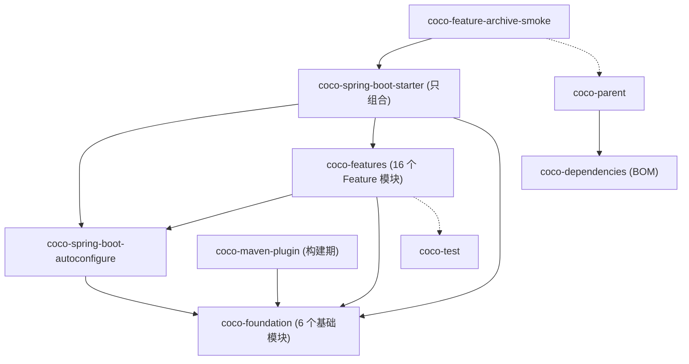
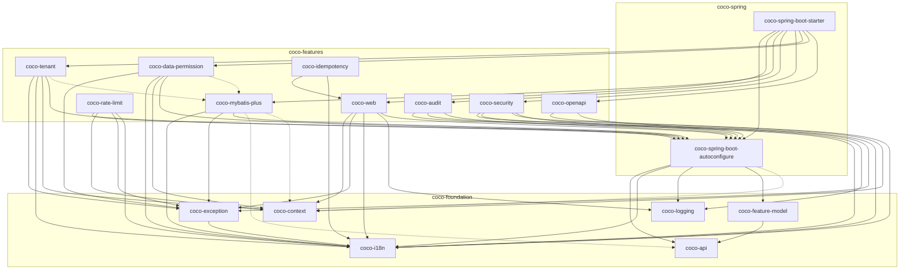
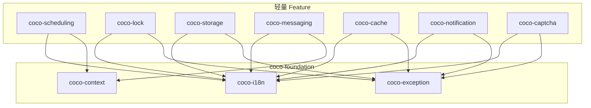
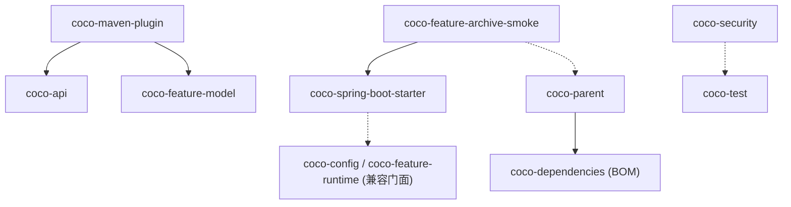

# 架构总览

> 本页回答：Coco Framework 的模块怎么分层、谁依赖谁、哪些模块只是 BOM / 父 POM / 构建工具 / 兼容门面 / 测试夹具，以及运行期是怎么把它们装配起来的。
> 事实来源：各模块 `pom.xml`、[`AGENTS.md`](https://github.com/patton174/coco-framework/blob/main/AGENTS.md)、[`GOVERNANCE.md`](https://github.com/patton174/coco-framework/blob/main/GOVERNANCE.md)、[`module-layout.md`](https://github.com/patton174/coco-framework/blob/main/coco-support/coco-document/architecture/module-layout.md)。文档之间存在已知出入的地方，会以“文档与实现存在出入：…”开头说明，并指出以哪个来源为准。

## 1. 一句话架构

Coco 是一个“单 starter + 可裁剪 Feature”的 Spring Boot Web 服务器框架：

- 业务应用继承 `coco-parent`，依赖 `coco-spring-boot-starter`；
- starter 只做依赖组合，行为全部落在 `coco-spring-boot-autoconfigure`（装配与运行期 Feature 计划）和 `coco-features/*`（各项 Web 服务器能力）里；
- 稳定契约与通用基础设施放在 `coco-foundation`；
- 构建期由 `coco-maven-plugin` 生成 Feature 清单并裁剪被禁用的 Feature（详见 [Feature 机制](Feature-System)）。

注意：Maven `groupId` 是 `io.github.patton174`，但 **Java 包根是 `io.github.coco`**，二者不要混用（见 [约定与规范](Conventions)）。

## 2. 分层与所有权

仓库顶层目录只表达“职责边界”，业务项目实际依赖的是其中发布到 Maven Central 的制品。所有权取自 [`GOVERNANCE.md`](https://github.com/patton174/coco-framework/blob/main/GOVERNANCE.md) 的 “Module ownership” 与 [`module-layout.md`](https://github.com/patton174/coco-framework/blob/main/coco-support/coco-document/architecture/module-layout.md)。

| 层（目录） | 职责 | 进入业务运行时？ | 反应堆中的模块 |
| --- | --- | --- | --- |
| `coco-build` | BOM、推荐父 POM、Maven 插件、发布期构建行为、2.x 旧坐标兼容 | 否（除 BOM/父 POM 影响依赖版本外，只在构建期生效） | `coco-dependencies`、`coco-parent`、`coco-maven-plugin`、`coco-compatibility/*`（9 个） |
| `coco-foundation` | 稳定契约与框架无关的基础设施 | 是 | `coco-api`、`coco-context`、`coco-exception`、`coco-feature-model`、`coco-i18n`、`coco-logging` |
| `coco-spring` | Spring Boot 集成与 starter 组合 | 是 | `coco-spring-boot-autoconfigure`、`coco-spring-boot-starter` |
| `coco-features` | 可独立启停的 Web 服务器能力 | 是（可被裁剪） | 16 个 Feature 模块（见 [Feature 机制](Feature-System)） |
| `coco-support` | 文档、开发工具、测试支持 | 否 | `coco-test`、`coco-feature-archive-smoke`（有 pom）；`coco-document`、`coco-tools`（无 pom） |

框架边界（`AGENTS.md` “Ecosystem Boundaries”）：`coco-framework` 是独立的 Web 服务器基础，**不得依赖** `coco-admin` 或 `coco-generate`；它们是独立仓库，业务/HTTP 验收由 `coco-admin/framework-acceptance` 承担，框架内不维护业务样例。

## 3. 模块角色：BOM / 父 POM / 构建专用 / 兼容门面 / 夹具

下表中的“角色”是按 pom 的实际内容归类的。

| 模块 | 打包 | 角色 | 说明（均核对过对应 `pom.xml`） |
| --- | --- | --- | --- |
| `coco-framework`（根 `pom.xml`） | pom | 仓库聚合 + 内部父 POM | 定义 `revision`、Java 17 编译目标、插件版本、Enforcer / Failsafe / flatten 等构建行为、`release` profile；除 `coco-feature-archive-smoke` 外，反应堆内模块的 `<parent>` 都是它 |
| `coco-dependencies` | pom | **BOM** | 导入 `spring-boot-dependencies`，并为 Coco 的库制品（含 9 个旧坐标和 `coco-test`）声明 `${project.version}` |
| `coco-parent` | pom | **业务应用父 POM** | 导入 BOM；设置 `coco.version=${revision}`、`coco.enforcer.skip=true`；在 `build/plugins` 绑定 `spring-boot:repackage`、`coco:features`、`coco:prune-package`。其自身的 `<parent>` 是 `coco-framework` |
| `coco-maven-plugin` | maven-plugin | **构建专用** | 提供 `features`、`prune-package` 两个 goal；依赖 `coco-api`、`coco-feature-model`；不应成为业务运行时依赖（`module-layout.md`） |
| `coco-features` | pom | 聚合 | 只聚合 16 个 Feature 模块，本身无代码 |
| `coco-spring-boot-starter` | jar | **starter（只组合）** | `src/main` 下没有任何文件，只有 pom 依赖组合；引入 `spring-boot-starter-web` |
| `coco-compatibility/*`（9 个） | jar | **兼容门面** | 无源码，每个只依赖其“规范制品”；各有 1 个 `*CompatibilityCompileProbe` 测试 |
| `coco-test` | jar | 测试支持 | 共享测试工具 `CocoTestSupport`；目前只有 `coco-security` 以 test 作用域使用 |
| `coco-feature-archive-smoke` | jar | **测试夹具** | 父 POM 是 `coco-parent`（因此会真实执行 `coco:features` 与 `coco:prune-package`）；`maven.deploy.skip` / `maven.install.skip` 为 `true`；由 Failsafe 校验 Boot 归档 |

兼容门面与规范制品的对应关系（各门面 pom 中唯一的 Coco 依赖）：

| 旧坐标（门面） | 规范制品 |
| --- | --- |
| `coco-config` | `coco-spring-boot-autoconfigure` |
| `coco-feature-runtime` | `coco-spring-boot-autoconfigure` |
| `coco-feature-web` | `coco-web` |
| `coco-feature-mybatis-plus` | `coco-mybatis-plus` |
| `coco-feature-audit` | `coco-audit` |
| `coco-feature-openapi` | `coco-openapi` |
| `coco-feature-tenant` | `coco-tenant` |
| `coco-feature-data-permission` | `coco-data-permission` |
| `coco-feature-security` | `coco-security` |

非反应堆目录（没有 pom，不参与 Maven 构建）：

- `coco-support/coco-document/`：仓库架构、发布、审计、计划与规格文档。
- `coco-support/coco-tools/`：仅开发期使用的仓库工具（有内容的是 `coco-agent-skills`）。

本地构建残留目录：如果你的工作区里出现 `coco-support/coco-test-support/` 或 `coco-spring/coco-config/`，它们只有 `target/` 和 `.flattened-pom.xml`，没有 pom 与源码，也不在根 `<modules>` 中。这两个目录没有被 Git 跟踪，`target/` 与 `.flattened-pom.xml` 都被 `.gitignore` 忽略，所以它们是本地构建留下的残留，不是仓库内容，删除即可。

文档与实现存在出入：`module-layout.md` 的迁移映射把 `coco-test` 的新主制品写成 `coco-test-support`，而当前 Reactor 的实际模块是 `coco-support/coco-test`（artifactId `coco-test`），以根 `pom.xml` 为准。

## 4. 分层与依赖方向规则

规则来自 [`AGENTS.md`](https://github.com/patton174/coco-framework/blob/main/AGENTS.md) 与 [`module-layout.md`](https://github.com/patton174/coco-framework/blob/main/coco-support/coco-document/architecture/module-layout.md)；右侧一列是本页用 pom 核对的现状。

| # | 规则 | 现状核对（pom 级） |
| --- | --- | --- |
| 1 | foundation 不得反向依赖 `coco-spring` 或具体 Feature | foundation 内的 Coco 依赖只有 `coco-exception → coco-i18n`、`coco-feature-model → coco-api`，符合 |
| 2 | 通用模块不得依赖具体 Feature 模块（`AGENTS.md`） | `coco-spring-boot-autoconfigure` 对 Feature 模块无依赖，符合 |
| 3 | starter 只组合、不承载行为（`AGENTS.md`） | `coco-spring-boot-starter` 无主代码，符合 |
| 4 | Feature 实现不得移入 starter | 同上 |
| 5 | 框架内部不得依赖仅为兼容保留的旧坐标（`module-layout.md` 基线 1） | 9 个门面中，只有 `coco-config`、`coco-feature-runtime` 被 `coco-spring-boot-starter` 以 **test 作用域**引用（用于 `CocoSpringCompositionClasspathTest`）；其余 7 个 `coco-feature-*` 门面没有任何依赖方 |
| 6 | 构建模块可读 Feature 元数据，但不能成为运行期业务依赖 | `coco-maven-plugin` 只依赖 `coco-api`、`coco-feature-model`（测试期另有 `coco-exception`） |
| 7 | Java 包名、公开 FQCN、配置前缀、feature id、插件 goal 不因目录或 artifactId 重命名而改变（`module-layout.md` 基线 4） | 例如 `coco-spring-boot-autoconfigure` 内仍保留 `io.github.coco.config`、`io.github.coco.feature.runtime.*`、`io.github.coco.feature.registry`、`io.github.coco.common.*` 等旧包名（`AGENTS.md` 称迁移期保留 FQCN） |

Feature 之间的依赖约束（由边表得出）：

- Feature 模块之间**基本不互相依赖**，唯一的硬依赖是 `coco-idempotency → coco-web`。
- `coco-tenant`、`coco-data-permission` 对 `coco-mybatis-plus` 是 `optional` 依赖，相应的 MyBatis-Plus 自动配置用 `@ConditionalOnClass` 保护。
- Feature **之间的启用依赖**（例如 `tenant` 依赖 `mybatis-plus` 与 `security`）不体现在 Maven 依赖里，而是写在 `StandardCocoFeatures` 中，由 Feature 计划解析时传播（见 [Feature 机制](Feature-System)）。

关于文档表述的两点说明（页面按代码现状写）：

- foundation 与 Spring 的关系：`module-layout.md` 只把其中的 feature 模型（`coco-feature-model`）描述为“与 Spring 无关”，它的 pom 只依赖 `coco-api` 与 `jackson-databind`。`coco-i18n`、`coco-logging` 的 pom 则依赖 `spring-context` / `spring-boot` / `slf4j-api`。该文档的规则是 foundation 不得依赖 `coco-spring` 或具体 Feature，并没有禁止依赖 Spring 基础库，所以两者不矛盾。
- `AGENTS.md` “Current Architecture” 只是摘要，没有列出 `coco-security`、`coco-rate-limit`、`coco-idempotency`、`coco-scheduling`、`coco-lock`、`coco-storage`、`coco-messaging`、`coco-cache`、`coco-notification`、`coco-captcha`，但它们都在 `coco-features/pom.xml` 与 `CocoFeature` 枚举里。模块清单以 pom 与源码为准。

## 5. 模块依赖图

> 图中约定：实线箭头 `A --> B` 表示 “A 依赖 B”；虚线 `A -.-> B` 表示 optional 或 test 作用域（各图下方有说明）。边全部由各模块 `pom.xml` 的 `<dependencies>` 提取，复现方法见本节末。

### 5.1 高层分层图（组级聚合示意）

这是把模块按层聚合后的示意图，用于建立整体印象；`module-layout.md` 里也有一张更粗的示意图。精确的模块级边见 5.2 – 5.4。



说明：`gStarter --> gFeat` 仅覆盖 14 个 Feature 模块（不含 `coco-rate-limit`、`coco-idempotency`）；`gFeat --> gAc` 只对部分 Feature 成立（见 5.2 / 5.3）；`gSmoke -.-> gParent` 表示它把 `coco-parent` 用作父 POM；`gFeat -.-> gTest` 仅 `coco-security` 以 test 作用域依赖 `coco-test`。

### 5.2 pom 级依赖图：基础层、Spring 层与“重”Feature

包含 foundation 6 个模块、autoconfigure、starter，以及依赖 `coco-spring-boot-autoconfigure` 或 `coco-web` 的 9 个 Feature。



读图要点：

- 虚线 = `<optional>true</optional>`：`coco-spring-boot-autoconfigure → coco-context`、`coco-mybatis-plus → coco-api / coco-context`、`coco-tenant / coco-data-permission → coco-mybatis-plus`。
- **`coco-rate-limit` 与 `coco-idempotency` 没有来自 starter 的边**：`CocoRateLimitStarterDependencyContractTest` 断言 starter 的直接依赖里不能出现这两者，它们由 `coco:features` 在构建期按 Feature 计划加入（`CocoFeaturesMojo.applyFeatureDependencies`）。
- starter 还直接依赖 `coco-api`、`coco-context`、`coco-exception`、`coco-i18n`、`coco-logging` 五个基础模块，以及下一小节的 7 个轻量 Feature；为避免连线过密，这些边没有画在图 5.2 中，完整列表见 5.5 的边表。
- `coco-openapi` 在 Maven 层只依赖 `coco-i18n` 与 `coco-spring-boot-autoconfigure`；它对 `web`、`security` 的依赖是 **Feature 级**依赖（`StandardCocoFeatures`），不是 Maven 依赖。

### 5.3 轻量 Feature：只依赖 foundation

`coco-scheduling`、`coco-lock`、`coco-storage`、`coco-messaging`、`coco-cache`、`coco-notification`、`coco-captcha` 七个模块在 Maven 层只依赖 foundation，不依赖 `coco-spring-boot-autoconfigure`，它们都在 starter 中。



### 5.4 构建与支持模块



读图要点：

- `parent --> bom` 是 `dependencyManagement` 中的 `import`，不是普通依赖。
- `smoke -.-> parent` 是 `<parent>` 继承关系；`starter3 -.-> facades`、`sec3 -.-> testsupport` 是 test 作用域。
- `coco-maven-plugin` 的 `coco-exception` 依赖也是 test 作用域，图中省略。

### 5.5 完整边表

“可选” = `<optional>true</optional>`；“测试期” = `<scope>test</scope>`。只列 Coco 模块（第三方依赖不在此表）。

| 模块 | 编译/运行期依赖 | 可选 | 测试期 |
| --- | --- | --- | --- |
| coco-api | — | — | — |
| coco-context | — | — | — |
| coco-i18n | —（依赖 spring-context、spring-boot） | — | — |
| coco-logging | —（依赖 spring-boot、slf4j-api） | — | — |
| coco-exception | coco-i18n | — | — |
| coco-feature-model | coco-api（另依赖 jackson-databind） | — | — |
| coco-spring-boot-autoconfigure | coco-api、coco-i18n、coco-logging、coco-feature-model | coco-context | — |
| coco-maven-plugin | coco-api、coco-feature-model | — | coco-exception |
| coco-web | coco-context、coco-exception、coco-i18n、coco-logging、coco-spring-boot-autoconfigure | — | — |
| coco-mybatis-plus | coco-i18n、coco-exception、coco-spring-boot-autoconfigure | coco-api、coco-context | — |
| coco-audit | coco-i18n、coco-logging、coco-spring-boot-autoconfigure | — | — |
| coco-security | coco-exception、coco-i18n、coco-context、coco-spring-boot-autoconfigure | — | coco-test |
| coco-tenant | coco-exception、coco-i18n、coco-context、coco-spring-boot-autoconfigure | coco-mybatis-plus | — |
| coco-data-permission | coco-exception、coco-i18n、coco-context、coco-spring-boot-autoconfigure | coco-mybatis-plus | — |
| coco-openapi | coco-i18n、coco-spring-boot-autoconfigure | — | — |
| coco-rate-limit | coco-spring-boot-autoconfigure、coco-context、coco-exception、coco-i18n | — | — |
| coco-idempotency | coco-web、coco-i18n | — | — |
| coco-scheduling | coco-context、coco-i18n | — | — |
| coco-lock | coco-exception、coco-i18n | — | — |
| coco-storage | coco-exception、coco-i18n | — | — |
| coco-messaging | coco-context、coco-i18n | — | — |
| coco-cache | coco-exception、coco-i18n | — | — |
| coco-notification | coco-exception、coco-i18n | — | — |
| coco-captcha | coco-exception、coco-i18n | — | — |
| coco-spring-boot-starter | coco-api、coco-context、coco-exception、coco-i18n、coco-logging、coco-web、coco-mybatis-plus、coco-audit、coco-security、coco-tenant、coco-data-permission、coco-openapi、coco-scheduling、coco-lock、coco-storage、coco-messaging、coco-cache、coco-notification、coco-captcha、coco-spring-boot-autoconfigure（另引入 `spring-boot-starter-web`） | — | coco-feature-runtime、coco-config（兼容门面） |
| coco-feature-archive-smoke | coco-spring-boot-starter（父 POM 为 coco-parent） | — | — |
| 9 个兼容门面 | 各自只依赖上文“门面与规范制品”表中的一个规范制品 | — | — |

关于版本声明的一个观察（仅描述现状）：根 `pom.xml` 的 `dependencyManagement` 没有登记 `coco-rate-limit`、`coco-scheduling`、`coco-lock`、`coco-storage`、`coco-messaging`、`coco-cache`、`coco-captcha`、`coco-notification`，而 `coco-build/coco-dependencies`（BOM）登记了全部；`coco-spring-boot-starter` 对其中 7 个（不含 `coco-rate-limit`）显式写了 `<version>${project.version}</version>`。新增模块时必须在 BOM 中登记（见 [指南：新增一个 Feature 模块](Guide-Add-Feature-Module)）；根 `pom.xml` 是否同时登记：设计意图未见文档说明，行为以 `pom.xml` 为准。

**如何复现边表**（只读命令，在仓库根目录的 PowerShell 中执行；输出的是“模块 -> Coco 依赖”，不区分 optional/test，需要区分时请直接读 pom）：

```powershell
Get-ChildItem coco-build, coco-foundation, coco-spring, coco-features, coco-support -Recurse -Filter pom.xml |
  Where-Object { $_.FullName -notmatch '\\target\\' } | ForEach-Object {
    $x = [xml](Get-Content -LiteralPath $_.FullName -Encoding UTF8)
    $ns = New-Object System.Xml.XmlNamespaceManager($x.NameTable)
    $ns.AddNamespace('m', 'http://maven.apache.org/POM/4.0.0')
    $deps = $x.SelectNodes('/m:project/m:dependencies/m:dependency/m:artifactId', $ns) |
      ForEach-Object { $_.InnerText } | Where-Object { $_ -like 'coco-*' }
    '{0} -> {1}' -f $x.project.artifactId, ($deps -join ', ')
  }
```

## 6. 运行期装配总览

1. **依赖进入 classpath**：业务应用依赖 `coco-spring-boot-starter`（以及 `coco:features` 在构建期按 Feature 计划补加的模块，例如 `coco-rate-limit`、`coco-idempotency`）。
2. **早期扩展点**（`coco-spring-boot-autoconfigure` 的 `META-INF/spring.factories`）：
   - `SpringApplicationRunListener` → `io.github.coco.spring.boot.banner.CocoSpringApplicationRunListener`
   - `EnvironmentPostProcessor` → `io.github.coco.spring.boot.logging.CocoLoggingEnvironmentPostProcessor`
   - `AutoConfigurationImportFilter` → `io.github.coco.feature.runtime.autoconfigure.CocoFeatureAutoConfigurationImportFilter`
3. **自动配置导入**：`coco-spring-boot-autoconfigure` 通过 `META-INF/spring/org.springframework.boot.autoconfigure.AutoConfiguration.imports` 注册 8 个自动配置（`CocoCommonAutoConfiguration`、`CocoCommonLoggingAutoConfiguration`、`CocoFeatureRegistryAutoConfiguration`、`CocoConfigAutoConfiguration`、`CocoFeatureRuntimeAutoConfiguration`、`CocoAutoConfiguration`、`CocoAsyncAutoConfiguration`、`CocoJacksonAutoConfiguration`）；每个 Feature 模块在自己的 `.imports` 中注册各自的自动配置。
4. **Feature 门控**：`CocoConfigAutoConfiguration` 提供 `CocoFeaturePlan` Bean；9 个 Feature 的自动配置用 `@ConditionalOnCocoFeature` 做门控，其余 7 个只靠自身 `enabled` 属性（详见 [Feature 机制](Feature-System)）。
5. **默认实现可替换**：各自动配置用 `@ConditionalOnMissingBean` 暴露默认 Bean，业务方可以自定义 Bean 覆盖；需要 Servlet 时叠加 `@ConditionalOnClass` / `@ConditionalOnWebApplication`（见 [新增或调整自动配置](Guide-Add-Auto-Configuration)）。
6. **国际化消息**：每个自动配置通过一个 `CocoMessageBundleRegistrar` Bean 注册自己的消息资源包，`CocoCommonAutoConfiguration` 汇总后构造 `cocoMessageSource`。

## 7. 构建期装配总览

业务应用继承 `coco-parent` 后，构建会依次发生：

- `process-classes` 阶段：`coco-maven-plugin:features` 解析 Feature 计划，写 `target/classes/META-INF/coco/features.json`，补加启用 Feature 的 runtime 依赖，并从 Maven artifact 集合中剔除被禁用 Feature 的裁剪项；
- `package` 阶段：`coco-maven-plugin:prune-package` 重写 Boot 归档，移除被禁用 Feature 的 `BOOT-INF/lib` 条目及索引行。它与 `spring-boot:repackage` 同处 `package` 阶段，`coco-parent` 先声明 `spring-boot-maven-plugin`、后声明 `coco-maven-plugin`，按 Maven 同阶段按声明顺序执行的规则，裁剪发生在 repackage 之后。

细节、参数与优先级见 [Feature 机制](Feature-System)；`coco-maven-plugin` 与 `coco-parent` 的模块说明见 [构建模块](Module-Build)。

## 8. 兼容策略摘要

摘自 [`module-layout.md`](https://github.com/patton174/coco-framework/blob/main/coco-support/coco-document/architecture/module-layout.md) “已发布兼容基线”（该文档称 `v2.0.1` 已向 Maven Central 发布 `coco-config`、`coco-feature-runtime`、`coco-feature-*`、`coco-test`、`coco-maven-plugin`）：

1. 新名称对应的制品是框架内部和新业务项目的主路径，框架内部不得继续依赖仅为兼容保留的旧坐标。
2. 每个已发布旧坐标在 2.x 内必须继续可解析，优先使用无源码兼容 JAR；经过验证后才可改为 relocation POM。
3. 兼容制品不得复制实现类、自动配置导入、`spring.factories`、消息资源或模板，实现只能有一个物理所有者。
4. Java 包名、公开 FQCN、配置前缀、feature id、插件 goal 不因目录或 artifactId 重命名而改变；变更需要单独的主版本兼容评审。
5. BOM 同时管理 2.x 主坐标和仍受支持的旧坐标；starter 只组合主坐标。
6. 旧坐标最早在下一主版本删除，并需要发布说明、替代坐标和经过验证的迁移路径。

## 相关页面

- [Feature 机制：构建期与运行期](Feature-System)
- [约定与规范](Conventions)
- [指南：新增一个 Feature 模块](Guide-Add-Feature-Module)
- [指南：新增或调整自动配置](Guide-Add-Auto-Configuration)
- [模块参考总览](Module-Overview)
- [构建模块：BOM、父 POM、Maven 插件与兼容门面](Module-Build)
- [基础模块：coco-foundation](Module-Foundation)
- [Spring 组合层：autoconfigure 与 starter](Module-Spring)
- [支持模块与仓库工具](Module-Support)
- [项目总览](Project-Overview)
- [速查：开发任务到文件/目录](Where-To-Find-Things)
- 仓库文档：[`AGENTS.md`](https://github.com/patton174/coco-framework/blob/main/AGENTS.md)、[`GOVERNANCE.md`](https://github.com/patton174/coco-framework/blob/main/GOVERNANCE.md)、[`module-layout.md`](https://github.com/patton174/coco-framework/blob/main/coco-support/coco-document/architecture/module-layout.md)
