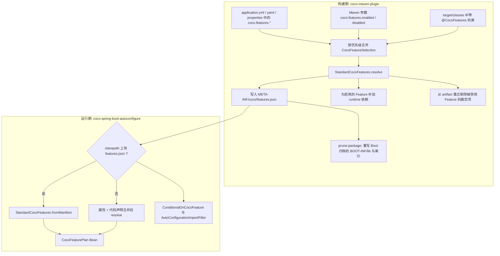

# Feature 机制：构建期与运行期

> 本页回答：Coco 的“Feature”是什么、16 个 Feature 如何定义和互相依赖、启停声明从哪里来并如何合并、构建期如何装配与裁剪、运行期如何按计划门控自动配置。
> 事实来源：`coco-api`、`coco-feature-model`、`coco-maven-plugin`、`coco-spring-boot-autoconfigure` 的源码，以及官网 [特性开关](https://github.com/patton174/coco-framework/blob/main/website/docs/feature-toggles.md)。

## 1. 先建立概念

- **Feature**：框架内置的一项可独立启停的能力，用稳定 id（如 `web`、`mybatis-plus`）标识，枚举在 `CocoFeature`（`coco-foundation/coco-api`）。
- **Feature 定义**：`StandardCocoFeatures`（`coco-foundation/coco-feature-model`）里写死的 16 条 `CocoFeatureDefinition`，包含 id、模块 artifactId、自动配置 FQCN、是否默认启用、Feature 依赖、可裁剪的 artifactId 集合。
- **Feature 计划**（`CocoFeaturePlan`）：把默认值、各来源的启停声明和依赖传播计算之后的最终结果。
- **Feature 清单**（manifest）：构建期把计划写成 `META-INF/coco/features.json` 放进业务应用产物，运行期优先读它。

框架有**两层开关**，不要混淆：

| 层 | 作用 | 示例 |
| --- | --- | --- |
| Feature 开关 | 决定“是否装配/打包这个模块”：影响构建期依赖补加与裁剪、manifest，以及运行期的 `@ConditionalOnCocoFeature` | `coco.features.disabled: [tenant]` |
| 模块级 `enabled` 属性 | 决定“模块已加载后具体行为是否生效” | `coco.idempotency.enabled=true` |

官网 [特性开关](https://github.com/patton174/coco-framework/blob/main/website/docs/feature-toggles.md) 对这两层也有面向业务使用者的说明。

## 2. 16 个 Feature 一览

所有 16 个 Feature 的 `defaultEnabled` 都是 `true`（`StandardCocoFeatures.feature(...)` 辅助方法写死）。因此在没有任何声明时，计划里 16 个都启用；`enabled` 声明的实际用途只是覆盖更低优先级来源的 `disabled`（见 §5）。

| id | 枚举 | 模块（artifactId） | Feature 依赖 | 运行期 `@ConditionalOnCocoFeature` | 模块级开关（默认值） |
| --- | --- | --- | --- | --- | --- |
| `web` | `WEB` | coco-web | — | 是 | 无总开关（子功能各有 `enabled`） |
| `mybatis-plus` | `MYBATIS_PLUS` | coco-mybatis-plus | — | 是 | `coco.mybatis-plus.pagination.enabled`（true） |
| `audit` | `AUDIT` | coco-audit | — | 是 | `coco.audit.enabled`（true） |
| `security` | `SECURITY` | coco-security | — | 是 | `coco.security.web.enabled`（true） |
| `tenant` | `TENANT` | coco-tenant | `mybatis-plus`、`security` | 是 | `coco.tenant.sql.enabled`（true） |
| `data-permission` | `DATA_PERMISSION` | coco-data-permission | `mybatis-plus`、`security` | 是 | `coco.data-permission.sql.enabled`（false） |
| `openapi` | `OPENAPI` | coco-openapi | `web`、`security` | 是 | `coco.openapi.enabled`（true） |
| `rate-limit` | `RATE_LIMIT` | coco-rate-limit | `web` | 是 | `coco.rate-limit.enabled`（false） |
| `idempotency` | `IDEMPOTENCY` | coco-idempotency | `web` | 是 | `coco.idempotency.enabled`（false） |
| `scheduling` | `SCHEDULING` | coco-scheduling | — | **否** | `coco.scheduling.enabled`（缺省为 true） |
| `lock` | `LOCK` | coco-lock | — | **否** | `coco.lock.enabled`（false） |
| `storage` | `STORAGE` | coco-storage | — | **否** | `coco.storage.enabled`（false） |
| `messaging` | `MESSAGING` | coco-messaging | — | **否** | `coco.messaging.enabled`（缺省为 true） |
| `cache` | `CACHE` | coco-cache | — | **否** | `coco.cache.enabled`（false） |
| `notification` | `NOTIFICATION` | coco-notification | — | **否** | `coco.notification.enabled`（false） |
| `captcha` | `CAPTCHA` | coco-captcha | — | **否** | `coco.captcha.enabled`（false） |

自动配置 FQCN（`StandardCocoFeatures` 中登记的主自动配置类）：

| id | 自动配置 FQCN |
| --- | --- |
| `web` | `io.github.coco.feature.web.CocoWebAutoConfiguration` |
| `mybatis-plus` | `io.github.coco.feature.mybatisplus.CocoMybatisPlusAutoConfiguration` |
| `audit` | `io.github.coco.feature.audit.CocoAuditAutoConfiguration` |
| `security` | `io.github.coco.feature.security.CocoSecurityAutoConfiguration` |
| `tenant` | `io.github.coco.feature.tenant.CocoTenantAutoConfiguration` |
| `data-permission` | `io.github.coco.feature.datapermission.CocoDataPermissionAutoConfiguration` |
| `openapi` | `io.github.coco.feature.openapi.CocoOpenApiAutoConfiguration` |
| `rate-limit` | `io.github.coco.feature.ratelimit.CocoRateLimitAutoConfiguration` |
| `idempotency` | `io.github.coco.feature.idempotency.CocoIdempotencyAutoConfiguration` |
| `scheduling` | `io.github.coco.scheduling.CocoSchedulingAutoConfiguration` |
| `lock` | `io.github.coco.feature.lock.CocoLockAutoConfiguration` |
| `storage` | `io.github.coco.storage.CocoStorageAutoConfiguration` |
| `messaging` | `io.github.coco.messaging.CocoMessagingAutoConfiguration` |
| `cache` | `io.github.coco.cache.CocoCacheAutoConfiguration` |
| `notification` | `io.github.coco.notification.CocoNotificationAutoConfiguration` |
| `captcha` | `io.github.coco.captcha.CocoCaptchaAutoConfiguration` |

关于“可裁剪 artifactId”：

- 一般情况下，裁剪集合就是模块自身 artifactId（`CocoFeatureDefinition` 的 5 参构造默认 `Set.of(artifactId)`）。
- `web`、`mybatis-plus`、`audit`、`security`、`tenant`、`data-permission`、`openapi` 额外包含旧的 `coco-feature-*` 名称，以便旧坐标也能被裁剪。
- `mybatis-plus` 还包含 `mybatis`、`mybatis-spring` 和一组 `mybatis-plus-*` 第三方 artifact（`mybatis-plus`、`-annotation`、`-core`、`-extension`、`-jsqlparser-4.9`、`-jsqlparser-common`、`-spring`、`-spring-boot-autoconfigure`、`-spring-boot-native-image`、`-spring-boot4-starter`）。

已退役的 `codegen`：`CocoFeatureIdParser`（构建期）对 `codegen` 给出专门的“已退役”报错，提示 CRUD 源码生成已迁到 `coco-generate`；`StandardCocoFeaturesTest.doesNotRegisterRetiredCodegenFeature` 断言它不再注册。内置的代码生成功能及其 feature id 已从框架中移除，`CocoFeature` 枚举当前为 16 项，Feature 数量以该枚举为准。

## 3. 数据模型（`coco-feature-model`，包 `io.github.coco.feature.model`）

| 类型 | 说明 |
| --- | --- |
| `CocoFeatureDefinition`（record） | `feature`、`artifactId`、`autoConfigurationClassName`、`defaultEnabled`、`dependencies`、`pruneArtifactIds` |
| `CocoFeatureSelection`（record） | 某个来源的 `enabled` / `disabled` 集合；`merge(lower, higher)` 按 Feature 逐项覆盖，**后者优先级更高** |
| `CocoFeaturePlan`（record） | `enabledFeatures`、`disabledFeatures`、`definitions`；`isEnabled(feature)`；`disabledByDependencyFeatures()` 区分“因依赖不满足而被连带禁用” |
| `CocoFeatureManifest`（record） | `schemaVersion`、`generatedBy`、`features`；`CURRENT_SCHEMA_VERSION = "1.1"`，`SUPPORTED_SCHEMA_VERSIONS = ["1.0", "1.1"]` |
| `CocoFeatureManifestEntry`（record） | 每个 Feature 一条：`id`、`artifactId`、`autoConfigurationClassName`、`defaultEnabled`、`enabled`、`dependencies`、`pruneArtifactIds` |
| `CocoFeatureManifestLoader` | `MANIFEST_LOCATION = "META-INF/coco/features.json"`；`load(ClassLoader)` / `read` / `write` |
| `StandardCocoFeatures` | `all()`、`allByFeature()`、`resolve(selection)`、`resolveEnabledFeatures(disabled)`、`toManifest(plan, generatedBy)`、`fromManifest(manifest)` |

清单 JSON 的字段名与上面两个 manifest record 的组件名一致，由 `CocoFeatureManifestLoader` 内的 Jackson `ObjectMapper` 序列化得到：根对象是 `schemaVersion`、`generatedBy`、`features`；`features` 的每个元素是 `id`、`artifactId`、`autoConfigurationClassName`、`defaultEnabled`、`enabled`、`dependencies`，schema `1.1` 起另有 `pruneArtifactIds`。读取时忽略未知字段，缺少 `pruneArtifactIds` 的 `1.0` 清单会按 artifactId 补齐（见 `StandardCocoFeaturesTest.readsLegacyFeatureManifestWithoutPruneArtifactIds`）。

## 4. 解析算法：`StandardCocoFeatures.resolve`

1. 把所有 `defaultEnabled` 的 Feature 置为启用（当前为全部 16 个）。
2. 并入 `selection.enabled`。
3. 移除 `selection.disabled`。
4. **依赖传播**：循环检查，若某个已启用 Feature 的依赖没有全部启用，就把它移除，直到不再变化。
5. 其余全部为 disabled。`disabledByDependencyFeatures()` 把“依赖不满足”导致的禁用单独列出来，日志里会打印。

常见传播结果（按 `StandardCocoFeatures` 中的依赖关系推得）：

| 你禁用了 | 连带被禁用 |
| --- | --- |
| `mybatis-plus` | `tenant`、`data-permission` |
| `security` | `tenant`、`data-permission`、`openapi` |
| `web` | `openapi`、`rate-limit`、`idempotency`（`audit` 不受影响，见 `StandardCocoFeaturesTest.keepsAuditEnabledWhenWebIsDisabled`） |

这意味着：被连带禁用的 Feature 即使被显式 `enabled` 也不会启用，因为第 4 步总会把依赖不满足的 Feature 移除。

## 5. 启停声明的来源与优先级

同一个 `CocoFeatureSelection` 内部，**禁用优先于启用**（`@CocoFeatures` 的 JavaDoc 与 `merge` 的实现一致）。不同来源之间，**后者覆盖前者**。

### 5.1 构建期（`CocoFeaturesMojo.resolveFeaturePlan`）

优先级从低到高：

| 顺序 | 来源 | 实现 |
| --- | --- | --- |
| 1 | `src/main/resources/application.yml`、`application.yaml`、`application.properties` 中的 `coco.features.enabled` / `coco.features.disabled`（三个文件依次合并，后者覆盖前者） | `CocoBuildFeatureConfigurationLoader` |
| 2 | Maven 参数 `coco.features.enabled` / `coco.features.disabled`（逗号分隔 id） | `CocoFeatureIdParser` |
| 3 | `target/classes` 中带 `@CocoFeatures` 的类 | `CocoAnnotatedFeatureScanner` |

实现细节：

- `CocoAnnotatedFeatureScanner` 只遍历项目自己的 `classesDirectory`，类名含 `$` 的嵌套类会被跳过；依赖 classpath 仅用于加载这些类。加载失败（`LinkageError` / `ClassNotFoundException`）会被静默忽略，不会让构建失败。
- 构建期只读 `src/main/resources` 下的文件，不会读取 `application-{profile}.yml` 或环境变量。
- 未知 id 会让构建失败（`MojoExecutionException: Failed to resolve Coco feature selection.`），报错中会列出合法 id；`codegen` 会给出退役提示。

### 5.2 运行期（没有 manifest 时）

- `CocoConfigAutoConfiguration.cocoFeaturePlan`：若 classpath 上存在 `META-INF/coco/features.json`，**直接 `StandardCocoFeatures.fromManifest`，运行期不再合并业务配置**；否则用“属性（`coco.features.*`，由 `CocoProperties` → `CocoFeatureProperties` 绑定）”与“代码声明”合并后 `resolve`，且代码声明优先级更高。
- 代码声明由 `CocoFeatureSelectionCollector` 收集：已废弃的 `CocoConfigurer` Bean（`@Deprecated(since = "1.0.0")`）和被 `@CocoFeatures` 标注的 Spring Bean 配置类。推荐使用 YAML 或 `@CocoFeatures`。
- 解析完成后会以 INFO 日志打印 `Coco features resolved from ...`，其中包含 `enabled`、`disabled`、`disabledByDependency`、属性与代码两路选择。

### 5.3 一个值得注意的行为（据源码）

`@ConditionalOnCocoFeature` 与 `CocoFeatureAutoConfigurationImportFilter` 使用的是 `CocoRuntimeFeatureResolver`。它在没有 manifest 时只通过 `Binder` 读取 `coco.features.enabled|disabled` **属性**，不会读取 `@CocoFeatures` / `CocoConfigurer` 的代码声明。因此在“没有 manifest”的场景（例如某些测试、没有经过 `coco:features` 的运行方式）里：

- `CocoFeaturePlan` Bean 与 `CocoFeatureManager` 会反映代码声明；
- 但 `@ConditionalOnCocoFeature` 门控的自动配置只反映属性。

正常的业务应用经过 `coco-parent` 构建后一定有 manifest，不受此影响。设计意图未见文档说明，行为以 `coco-spring/coco-spring-boot-autoconfigure/src/main/java/io/github/coco/feature/runtime/condition/CocoRuntimeFeatureResolver.java` 为准；请不要在文档或代码中依赖这一差异。

## 6. Maven 参数与 goal

| goal | 默认阶段 | 说明 |
| --- | --- | --- |
| `coco:features` | `process-classes`（`requiresDependencyResolution = RUNTIME`，`threadSafe = true`） | 解析计划、写 manifest、补依赖、剔除被禁用 Feature 的 artifact |
| `coco:prune-package` | `package`（`threadSafe = true`） | 重写 Spring Boot 归档，移除被禁用 Feature 的嵌套 jar |

`coco:features` 参数（`@Parameter`）：

| 属性 | 默认值 | 说明 |
| --- | --- | --- |
| `coco.features.enabled` | 空 | 逗号分隔的 Feature id |
| `coco.features.disabled` | 空 | 逗号分隔的 Feature id |
| `coco.features.featureGroupId` | `io.github.patton174` | 补加依赖时使用的 groupId |
| `coco.features.featureVersion` | `${project.version}` | 补加依赖时使用的版本；`coco-parent` 把它设为 `${coco.version}`（即 `${revision}`） |
| `coco.features.skip` | `false` | 跳过整个 goal；`prune-package` 也读取同名属性 |

`pom` 打包的项目会被两个 goal 跳过。

### 6.1 `coco:features` 的执行动作

1. `writeManifest`：写入 `target/classes/META-INF/coco/features.json`，`generatedBy = "coco-maven-plugin"`。
2. `applyFeatureDependencies`：为每个**启用**的 Feature 补加 `runtime` 作用域依赖 `featureGroupId:artifactId:featureVersion`；已存在则跳过。这就是 `coco-rate-limit`、`coco-idempotency` 虽然不在 starter 里，仍能随 Feature 计划进入应用的原因。
3. `pruneDisabledFeatureArtifacts`：从 Maven 已解析的 artifact 集合中剔除被禁用 Feature 的“可裁剪 artifactId”。groupId 限定：`coco-feature-*` 用 `featureGroupId`，`mybatis-plus*` 用 `com.baomidou`，`mybatis` 与 `mybatis-spring` 用 `org.mybatis`。

### 6.2 `coco:prune-package` 的执行动作

- 读取 `target/classes/META-INF/coco/features.json`，取出所有 `enabled=false` 条目的 `pruneArtifactIds`；没有清单或没有被禁用项则跳过。
- 在 Boot 归档中删除匹配的 `BOOT-INF/lib/<artifactId>-<版本>.jar`，并同步过滤 `BOOT-INF/classpath.idx` 与 `BOOT-INF/layers.idx` 中的对应行。文件名匹配要求 artifactId 后跟 `-` 且后面的片段“像版本”，以降低对业务扩展 jar 的误伤。
- 修改归档前，把原始归档备份为 `target/coco-prune.original.jar`；归档不存在或内容无变化时不改动。

### 6.3 业务应用如何接入

业务应用继承 `coco-parent` 即可：它在 `build/plugins` 中绑定 `spring-boot-maven-plugin:repackage`（execution id `spring-boot-repackage`）、`coco-maven-plugin:features`（`coco-feature-assembly`）、`coco-maven-plugin:prune-package`（`coco-package-prune`）。详见 [构建模块](Module-Build)。

## 7. 流程图



图中 `man --> chk` 表示“构建期产出的清单被运行期读取”。`cond` 虽然也先看清单，但在无清单时的行为与 `plan` 不同，见 §5.3。

## 8. 运行期门控细节

### 8.1 `@ConditionalOnCocoFeature`

- 位置：`io.github.coco.feature.runtime.condition.ConditionalOnCocoFeature`，可标注在类或方法上，`value()` 是 `CocoFeature`。
- 判定：`OnCocoFeatureCondition` 调用 `CocoRuntimeFeatureResolver.resolve(environment, classLoader).isEnabled(feature)`。
- 使用范围：全仓库只出现在 9 个 Feature 的自动配置上——web、mybatis-plus、audit、security、tenant、data-permission、openapi、rate-limit、idempotency（含它们的 Redis / MyBatis-Plus 子配置）。

### 8.2 `CocoFeatureAutoConfigurationImportFilter`

在 `spring.factories` 中注册为 `AutoConfigurationImportFilter`，用于避免“Feature 被禁用但第三方自动配置仍然生效”：

- 当 `mybatis-plus` Feature 未启用时，过滤 MyBatis-Plus 的 5 个自动配置：`MybatisPlusInnerInterceptorAutoConfiguration`、`IdentifierGeneratorAutoConfiguration`、`MybatisPlusLanguageDriverAutoConfiguration`、`MybatisPlusAutoConfiguration`、`DdlAutoConfiguration`。
- 当 `mybatis-plus` 未启用、**且**没有配置数据源属性（`spring.datasource.url|jdbc-url|driver-class-name|jndi-name|type`）、**且** classpath 上没有嵌入式数据库驱动（`org.h2.Driver`、`org.hsqldb.jdbcDriver`、`org.apache.derby.jdbc.EmbeddedDriver`）时，同时过滤 Spring Boot 的 `DataSourceAutoConfiguration`、`JndiDataSourceAutoConfiguration`、`XADataSourceAutoConfiguration`，避免没有数据库配置的应用因为数据源而启动失败。

### 8.3 只靠模块属性的 7 个 Feature

`scheduling`、`lock`、`storage`、`messaging`、`cache`、`notification`、`captcha` 的自动配置类上**没有** `@ConditionalOnCocoFeature`，运行期是否生效只看各自的 `coco.<x>.enabled` 属性。对这 7 个模块：

- `coco.features.disabled` 会在**构建期**影响依赖补加、裁剪和 manifest；
- 运行期若依赖仍在 classpath 上（例如没有经过 `coco:features` 裁剪的运行方式），是否装配取决于属性默认值：`scheduling`、`messaging` 缺省为启用（`matchIfMissing = true`），其余缺省为关闭。

一个相关的观察：`@ConditionalOnCocoFeature` 定义在 `coco-spring-boot-autoconfigure`，而这 7 个模块的 pom 都没有依赖 `coco-spring-boot-autoconfigure`（只依赖 foundation，见 [架构总览](Architecture)）；使用该注解的 Feature 则都直接或经 `coco-web` 间接依赖它。这 7 个 Feature 的自动配置不使用该注解的原因：设计意图未见文档说明，行为以各模块下的 `*AutoConfiguration` 源码为准；本页只如实描述，不推测动机。

## 9. 使用示例

YAML（来自官网 [特性开关](https://github.com/patton174/coco-framework/blob/main/website/docs/feature-toggles.md)，已与源码核对 id 与行为）：

```yaml
coco:
  features:
    disabled:
      - mybatis-plus
      - tenant
      - data-permission
```

注解（标注在 Spring 配置类上；同一来源内禁用优先）：

```java
@CocoFeatures(disabled = {
        CocoFeature.TENANT,
        CocoFeature.DATA_PERMISSION
})
@Configuration(proxyBeanMethods = false)
class ApplicationCocoConfiguration {
}
```

Maven 命令行覆盖（PowerShell 下给 `-D` 参数加单引号，避免逗号被当作数组分隔符；命令取自 `coco-maven-plugin` 的 `@Parameter` 定义）：

```powershell
mvn -B package '-Dcoco.features.disabled=tenant,data-permission'
mvn -B package '-Dcoco.features.skip=true'
```

## 10. 排错提示

- **自动配置没有生效**：依次确认——Feature 是否被禁用（含因依赖被连带禁用，查看启动日志 `Coco features resolved from ...` 里的 `disabledByDependency`）；`features.json` 是否存在且是最新的（它**优先于**属性）；`AutoConfigurationImportFilter` 是否过滤了它；模块级 `enabled` 属性；classpath 上是否有对应依赖。
- **`target/classes/META-INF/coco/features.json` 为 0 字节**：构建被中断后，`target/` 下的生成文件（例如 `features.json`、`spring-configuration-metadata.json`）可能残留为 0 字节。0 字节清单无法被 `CocoFeatureManifestLoader.read` 解析，读取时会抛出 `UncheckedIOException`（`Failed to parse Coco feature manifest`）。遇到时先 `mvn clean` 后重新构建，可参考 [FAQ 与故障排查](FAQ-Troubleshooting)。
- **想验证裁剪是否正确**：`coco-feature-archive-smoke` 的 Failsafe 测试 `FeatureArchiveSmokeIT` 会读取归档并校验 Feature 清单与被裁剪的库，见 [支持模块与仓库工具](Module-Support)。
- **新增 Feature**：必须同步更新 `StandardCocoFeatures` 与 `StandardCocoFeaturesTest`，步骤见 [新增一个 Feature 模块](Guide-Add-Feature-Module)。

## 相关页面

- [架构总览](Architecture)
- [约定与规范](Conventions)
- [指南：新增一个 Feature 模块](Guide-Add-Feature-Module)
- [指南：新增或调整自动配置](Guide-Add-Auto-Configuration)
- [构建模块：BOM、父 POM、Maven 插件与兼容门面](Module-Build)
- [Spring 组合层：autoconfigure 与 starter](Module-Spring)
- [模块参考总览](Module-Overview)
- [FAQ 与故障排查](FAQ-Troubleshooting)
- [术语表](Glossary)
- 官网用户文档：[特性开关](https://github.com/patton174/coco-framework/blob/main/website/docs/feature-toggles.md)
- 仓库文档：[`AGENTS.md`](https://github.com/patton174/coco-framework/blob/main/AGENTS.md)、[`module-layout.md`](https://github.com/patton174/coco-framework/blob/main/coco-support/coco-document/architecture/module-layout.md)
