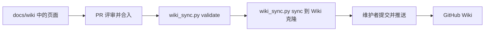

# 指南：维护与发布本 Wiki

本页回答：这个 Wiki 的内容从哪里来、怎么修改和新增页面、怎么用 `wiki_sync.py` 校验与预览，以及维护者如何把它发布到 GitHub Wiki。

## 1. 概述

GitHub Wiki 是仓库 [`docs/wiki`](https://github.com/patton174/coco-framework/tree/main/docs/wiki) 的**发布镜像**，不是独立维护的文档站：

- `docs/wiki/` 是**唯一事实源**。页面的修改、评审和历史都在主仓库里，和代码一样通过 PR 完成。
- 真实的 Wiki 仓库是单向镜像：维护者用 [`.github/scripts/wiki_sync.py`](https://github.com/patton174/coco-framework/blob/main/.github/scripts/wiki_sync.py) 把 `docs/wiki/` 的页面复制过去，再手动提交并推送。
- **不要在 GitHub 网页上直接编辑 Wiki 页面。** Wiki 仓库没有分支保护、CODEOWNERS 或 CI，网页上的修改会绕开 PR 评审；而且下一次同步会用 `docs/wiki/` 的内容覆盖它们，网页上的改动会丢失。
- Wiki 面向开发者，是导读而不是规范源：事实以源码、`pom.xml`、`AGENTS.md`、`CONTRIBUTING.md`、`GOVERNANCE.md` 和工作流为准。



Wiki 的访问地址是 `https://github.com/patton174/coco-framework/wiki`，在首次手动发布完成之前该地址不可用；那之前请直接阅读 `docs/wiki/` 下的源文件，或从 [`docs/README.md`](https://github.com/patton174/coco-framework/blob/main/docs/README.md) 进入。

## 2. 目录与命名规则

`docs/wiki/` 是**扁平**目录，所有镜像页面直接放在其中：

| 规则 | 说明 |
| --- | --- |
| 页面文件名 | 英文 Title-Case，单词用连字符连接，只含 ASCII，正则为 `^[A-Z][A-Za-z0-9]*(-[A-Z0-9][A-Za-z0-9]*)*\.md$` |
| 组前缀 | 指南用 `Guide-`，模块参考用 `Module-`，例如 `Guide-Testing`、`Module-Web` |
| 特殊页 | `Home.md`（首页，必须叫 `Home`）、`_Sidebar.md`（侧栏）、`_Footer.md`（页脚）；三者必须存在，文件名大小写精确 |
| 不允许 | 子目录、非 `.md` 文件、隐藏文件，以及仅大小写不同的重名文件 |
| 不镜像的文件 | 目录里的 `README.md` 只在主仓库浏览时使用，同步时会被排除 |
| 页面 H1 | 简体中文，每页一个；页面标题与文件名无需一致，链接以文件名（去掉 `.md`）为准 |

页面名一旦被其他页面、侧栏或外部链接引用，就不要随意改名；确需改名时，同一个 PR 里同步修改所有引用（见第 6 节）。

## 3. 编写规范

### 3.1 页面结构与格式

- 简体中文为主；标识符、路径、命令、类名不翻译。语气平实，不使用营销用语。
- 每页一个中文 H1，开头用一句“本页回答…”说明用途，结尾保留“相关页面”小节。
- 不使用 YAML front matter（文件不能以 `---` 开头）。
- 文件编码为 UTF-8、无 BOM、LF 换行、以单个换行结尾。Windows 上请确认编辑器按此保存，否则 `validate` 会报告 W005。
- Mermaid 图用 ` ```mermaid ` 围栏保留；节点 id 只用字母数字，不使用 `click` 或样式指令，每张图不超过 25 个节点。
- 表格、代码块和命令保持可直接复制运行；路径用占位符，不写个人环境的具体值。
- 页面之间只链接 Wiki 内的页面；不要链接 `docs/wiki` 目录里的 `README.md`（它不在 Wiki 里）。

### 3.2 链接写法

三类链接的写法固定，`validate` 会逐条检查：

| 目标 | 正确写法 | 常见错误（会被拒绝） |
| --- | --- | --- |
| Wiki 内部页面 | `[文字](Page-Name)`，例如 `[架构总览](Architecture)` | 带 `.md` 后缀、带 `./` 或 `../`、带目录前缀、带盘符或反斜杠 |
| Wiki 页内或跨页锚点 | `[文字](#anchor)` 或 `[文字](Page-Name#anchor)` | 锚点在目标页标题里找不到 |
| 仓库文件 | `[文字](https://github.com/patton174/coco-framework/blob/main/<仓库内路径>)` | 相对路径；路径大小写与磁盘不一致；指向不存在的文件 |
| 仓库目录 | `[文字](https://github.com/patton174/coco-framework/tree/main/<目录>)` | 目录用了 `blob`，或文件用了 `tree` |
| 外部站点 | `[文字](https://…)` | 使用 `http://` 链接 |

补充规则：

- 锚点按 GitHub 的标题 slug 规则匹配：小写、去标点、空格换成连字符、保留中文，重复标题依次加 `-1`、`-2`。
- 仓库链接必须指向真实存在的路径，且路径大小写与磁盘逐字符一致。不要链接未被跟踪的草稿目录。
- 代码样式（反引号）里的页面名或路径不会被当作链接；凡是引导读者去看另一个页面，请写成链接。

### 3.3 无法确认的事实怎么写

不要留下表示“尚未确认”的占位标记。先去源码、`pom.xml`、工作流里找证据，再按结果处理：

- 能核实：直接改写为事实陈述，最好附上来源路径。
- 文档与实现确有出入：写成 `文档与实现存在出入：<A 的说法> 与 <B 的说法> 不一致，以 <权威来源> 为准。`
- 设计意图没有文档说明：写成 `设计意图未见文档说明，行为以 <源码路径> 为准。`

发现出入时，欢迎同时提 Issue（可用仓库的“文档或 Wiki 问题”表单）或 PR 修正文档。

### 3.4 公共页面的卫生要求

Wiki 是公开页面。提交前请确认：

- 不出现个人环境的信息：带盘符的绝对路径、用户名、“在某台机器上观察到”之类的一次性现象。JDK 路径用占位符，例如 `$env:JAVA_HOME='<JDK21_HOME>'`，并说明换成你自己的安装目录。
- 不提及尚未提交的本地改动，也不写某个具体提交 SHA 来标注内容快照。需要说明时用统一说法：“内容对应仓库 `main` 分支；以源码为准，发现出入请提 Issue 或 PR。”
- 密钥、令牌、App ID、安装 ID 只写键名（例如 `CENTRAL_USERNAME`、`GPG_PRIVATE_KEY`），不写值；不写邮箱地址。
- 故障排查条目写成通用做法，不写某一次运行的数量、大小、时间戳。
- 不链接、不提及仓库里未被跟踪的草稿目录。

## 4. 修改流程

### 4.1 修改已有页面

1. 按 [CONTRIBUTING.md](https://github.com/patton174/coco-framework/blob/main/CONTRIBUTING.md) 从最新 `dev` 建 `dev-<你的 GitHub 用户名>` 分支（维护者用 agent 分支和 `Open Agent Pull Request`，见 [指南：分支、PR、CI 与发布流程](Guide-Release-And-Workflow)）。
2. 直接修改 `docs/wiki/` 下对应的 `.md` 文件，遵守第 3 节的规范。
3. 内容涉及的事实要回到源码核对，不要只改措辞。
4. 运行第 4.3 节的校验命令，全部通过后再提 PR。

### 4.2 新增页面并登记到 `_Sidebar.md`

1. 按第 2 节选定文件名，在 `docs/wiki/` 下新建，例如 `Guide-Example-Topic.md`（占位名）。页面以中文 H1 开头，写“本页回答…”，结尾加“相关页面”。
2. 在 `_Sidebar.md` 里把新页面加到合适的分组下。侧栏用加粗分组标题加无序列表，链接文字尽量短：

   ```markdown
   **约定与指南**

   - [约定](Conventions)
   - [新增 Feature](Guide-Add-Feature-Module)
   - [示例主题](Guide-Example-Topic)
   ```

3. 在 `Home.md` 的目录表里加一行，写明页面和内容简介。
4. 在相关页面的“相关页面”小节加上反向链接。
5. 运行 `validate`：`_Sidebar.md` 漏掉任何一个内容页，都会被 W040 拒绝。

### 4.3 本地校验与预览

所有命令在仓库根目录运行，只依赖 Python 标准库（CI 使用 Python 3.12）：

```powershell
# 工具自身的单元测试
python .github/scripts/test_wiki_sync.py

# 校验 docs/wiki 下的全部页面
python .github/scripts/wiki_sync.py validate

# 同时打印统计：页面数、各类链接数、Mermaid 围栏数、标题数
python .github/scripts/wiki_sync.py validate --stats
```

`validate` 的输出是确定性的：问题行格式为 `<相对路径>:<行号>: <规则ID>: <说明>`，按路径、行号、规则 ID 排序，末行是摘要。退出码 `0` 表示通过，`1` 表示校验失败（使用 `--check` 时表示存在漂移），`2` 表示用法或 I/O 错误。可选参数 `--wiki-dir`（默认 `docs/wiki`，相对 `--repo-root` 解析）和 `--repo-root`（默认当前目录）用于指向别的位置。

主要规则 ID：

| 规则 | 检查内容 |
| --- | --- |
| W001 | 目录扁平，只含 `.md`，无隐藏文件 |
| W002 / W003 | 文件名符合正则、无仅大小写不同的重名；`Home.md`、`_Sidebar.md`、`_Footer.md` 必须存在 |
| W005 / W006 | UTF-8、无 BOM、LF、单个结尾换行；不得有 YAML front matter |
| W010 / W011 / W012 | 内部链接形态正确、目标页面存在、锚点存在 |
| W013 | 仓库链接指向真实存在的路径，`blob` 对应文件、`tree` 对应目录 |
| W020 / W021 | 代码围栏成对；Mermaid 围栏非空且图类型合法 |
| W030 / W031 | 公共卫生（未决标记、带盘符路径、个人环境措辞、邮箱、旧目录路径等）；密钥形态 |
| W040 / W041 | 侧栏覆盖全部内容页；页脚包含仓库、`CHANGELOG.md`、`CONTRIBUTING.md`、`LICENSE` 的链接 |
| W050 | `sync` 的目标目录未通过安全检查 |

预览要发布的变更时，用 `sync` 对一个 Wiki 克隆目录做试运行；它**只在两个本地目录之间复制文件，不调用 `git`，也不联网**：

```powershell
# 只打印计划，不写文件；逐行输出 ADD / UPDATE / REMOVE / SAME 加文件名
python .github/scripts/wiki_sync.py sync --target <wiki-clone-dir> --dry-run

# 只比较，有差异时退出码为 1
python .github/scripts/wiki_sync.py sync --target <wiki-clone-dir> --check
```

`sync` 的行为：

- 源是 `docs/wiki/` 下除 `README.md` 以外的全部 `*.md`，字节原样复制。
- 默认会删除目标顶层多余的 `*.md`；加 `--no-prune` 可以关闭删除。
- 永远不会触碰目标里的 `.git/`、非 `.md` 文件和子目录。
- 目标目录必须已存在；指向 `docs/wiki` 内部、包含 `pom.xml` 或 `AGENTS.md` 的目录会被拒绝，避免误指向主仓库根目录。

在仓库里直接浏览 `docs/wiki/*.md` 时，页面之间不带 `.md` 的链接通常不会跳转到对应文件，这是 Wiki 链接写法的取舍；链接是否有效以 `validate` 为准，最终效果以发布后的 Wiki 为准。

### 4.4 提 PR

- PR 目标分支是 `dev`，按 PR 模板填写变更意图、影响范围和实际执行的验证；模板的 Checklist 有 Wiki 同步（`docs/wiki`、`_Sidebar.md`、`validate`）和 `CHANGELOG.md` 两项。
- 用户可见的文档基础设施变更（例如新增页面类别、工具行为变化）在 [`CHANGELOG.md`](https://github.com/patton174/coco-framework/blob/main/CHANGELOG.md) 的 `[Unreleased]` 下记一条。
- PR 合入后页面还没有出现在真实 Wiki 里：发布是维护者的独立手动步骤（下一节）。

## 5. 发布到 GitHub Wiki（维护者手动）

发布由有 Wiki 写权限的维护者在本地完成。Agent 与 CI 不执行这些步骤，也不会推送 Wiki。

前提：真实 Wiki 仓库 `https://github.com/patton174/coco-framework.wiki.git` 要等到有人在浏览器里创建了第一个页面之后才存在，在此之前无法克隆。

1. 确认仓库 Settings → Features → Wikis 已启用，并保持 “Restrict editing to collaborators only” 勾选。
2. 在浏览器里打开仓库的 Wiki 标签页，选择 Create the first page，标题填 `Home`，内容随意，保存。这一步只为初始化 Wiki 仓库，内容会被同步覆盖。
3. 在主仓库**之外**克隆 Wiki 仓库（使用 HTTPS，沿用 `AGENTS.md` 约定的 GitHub CLI 凭据助手），并确认默认分支名：

   ```powershell
   git clone https://github.com/patton174/coco-framework.wiki.git ..\coco-framework.wiki
   git -C ..\coco-framework.wiki branch --show-current   # 通常是 master；只有默认分支上的推送才生效
   ```

4. 在主仓库里，基于已合并的 `main`（或评审通过的 `dev`），先校验再预览：

   ```powershell
   python .github/scripts/test_wiki_sync.py
   python .github/scripts/wiki_sync.py validate
   git -C ..\coco-framework.wiki pull --ff-only
   python .github/scripts/wiki_sync.py sync --target ..\coco-framework.wiki --dry-run
   ```

5. 确认计划无误后真正同步，并在 Wiki 克隆里检查差异：

   ```powershell
   python .github/scripts/wiki_sync.py sync --target ..\coco-framework.wiki
   git -C ..\coco-framework.wiki status --short
   git -C ..\coco-framework.wiki diff --stat
   ```

6. 在 Wiki 克隆里提交并推送：

   ```powershell
   git -C ..\coco-framework.wiki add -A
   git -C ..\coco-framework.wiki commit -m "docs: sync wiki from coco-framework main"
   git -C ..\coco-framework.wiki push origin HEAD
   ```

7. 在浏览器里验证：`Home` 能渲染，侧栏与页脚出现，`Architecture` 里的 Mermaid 图能渲染，抽查几个页内链接和仓库链接。
8. 之后检查漂移：在 Wiki 克隆里 `git pull --ff-only`，再运行 `python .github/scripts/wiki_sync.py sync --target ..\coco-framework.wiki --check`；有差异时退出码为 1。需要回滚时，在 Wiki 克隆里用 `git revert`。
9. 首次发布完成后的后续事项由维护者另行处理：在 README 片段里加入 Wiki 入口并运行 `node .github/readme/scripts/render.mjs --write` 与 `--check`；去掉 `docs/README.md`、`SUPPORT.md` 中“首次发布前不可用”的提示。

## 6. 常见问题

- **我在网页上改了 Wiki 页面，为什么又变回去了？** `sync` 以 `docs/wiki/` 为准覆盖目标页面，还会删除目标里多出来的 `*.md`。把改动做在 `docs/wiki/` 里并走 PR；已经在网页上做过的修改，需要手动搬回 `docs/wiki/`。
- **页面改名要注意什么？** 同一个 PR 里同时改文件名、全部引用它的内部链接、`_Sidebar.md` 和 `Home.md`；`validate` 的 W011（目标页不存在）和 W040（侧栏）会帮你找漏。`sync` 会删除目标里的旧文件，不会为旧页面名保留重定向。
- **为什么首页必须叫 `Home`？** GitHub Wiki 以名为 `Home` 的页面作为首页，`validate` 也会要求 `Home.md` 精确存在（W003）。
- **推送后页面没有变化？** 只有默认分支上的推送才会生效。用 `git -C ..\coco-framework.wiki branch --show-current` 确认分支名，必要时 `git push origin HEAD:<默认分支名>`。
- **回滚一次错误的发布怎么做？** 在 Wiki 克隆里 `git revert` 对应提交并推送；同时在 `docs/wiki/` 修正源内容，否则下一次同步会把问题内容重新发布出去。
- **`validate` 报 W013，但链接看起来没问题？** 仓库链接的路径大小写必须与磁盘逐字符一致，并且 `blob` 只能指向文件、`tree` 只能指向目录；新文件要先存在于仓库里才能被链接。
- **文件在 Windows 上改了大小写，Git 里没有变化？** Windows 文件系统不区分大小写，先改成临时名再改回目标名，或使用 `git mv`，并确认磁盘上的文件名大小写正确。

## 相关页面

- [Wiki 首页](Home)
- [指南：分支、PR、CI 与发布流程](Guide-Release-And-Workflow)
- [指南：测试约定](Guide-Testing)
- [约定与规范](Conventions)
- [速查：开发任务到文件/目录](Where-To-Find-Things)
- 仓库文档：[`docs/README.md`](https://github.com/patton174/coco-framework/blob/main/docs/README.md)、[`CONTRIBUTING.md`](https://github.com/patton174/coco-framework/blob/main/CONTRIBUTING.md)、[`AGENTS.md`](https://github.com/patton174/coco-framework/blob/main/AGENTS.md)、[`CHANGELOG.md`](https://github.com/patton174/coco-framework/blob/main/CHANGELOG.md)
