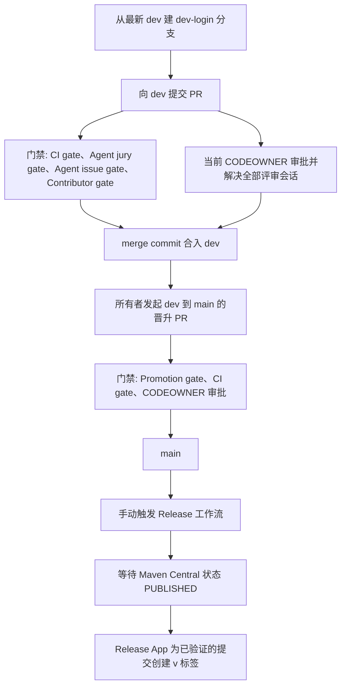
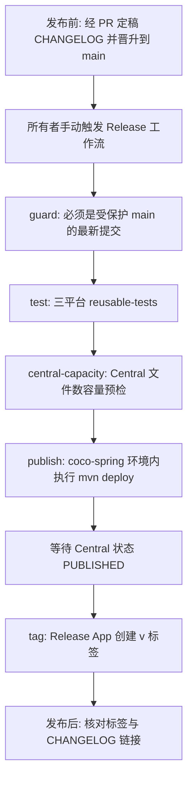

# 指南：分支、PR、CI 与发布流程

本页回答：我该从哪个分支开始、PR 要过哪些门禁、CI 里实际跑了什么，以及一次正式发布（含 `CHANGELOG.md` 定稿）是怎么走完的。

> 本页是**导读**，规则以 [CONTRIBUTING.md](https://github.com/patton174/coco-framework/blob/main/CONTRIBUTING.md)、[GOVERNANCE.md](https://github.com/patton174/coco-framework/blob/main/GOVERNANCE.md)、[AGENTS.md](https://github.com/patton174/coco-framework/blob/main/AGENTS.md)、[release.md](https://github.com/patton174/coco-framework/blob/main/coco-support/coco-document/release.md) 和 `.github/workflows/*.yml` 为准；它们在分支流上的出入见第 1 节。内容对应仓库 `main` 分支；以源码为准，发现出入请提 Issue 或 PR。

## 1. 先弄清你是哪种角色

| 角色 | 分支与入口 | 谁来开 PR | 出处 |
| --- | --- | --- | --- |
| 外部 / 普通贡献者 | 从最新 `dev` 建 `dev-<你的 GitHub 用户名>` 分支，PR 目标是 `dev` | 你自己 | `CONTRIBUTING.md`、`GOVERNANCE.md` |
| 维护者 / Agent 改动 | 推到同仓库的 agent 分支（默认前缀 `codex/*`，允许前缀由仓库变量 `COCO_AGENT_BRANCH_PREFIXES` 决定，例如 `codex/,claude/`），再运行受保护的 `Open Agent Pull Request` 工作流；PR 的目标分支是 `dev` | Coco App（人类维护者再提供审批） | `CONTRIBUTING.md`、`AGENTS.md`、[`agent-open-pr.yml`](https://github.com/patton174/coco-framework/blob/main/.github/workflows/agent-open-pr.yml) |
| 仓库所有者 | 把 `dev` 晋升到 `main`，随后手动触发 `Release` | 所有者 | `GOVERNANCE.md`、`release.md` |

要点：

- 分支后缀必须是**作者本人**的登录名，`dev-someone-else` 会被拒绝；不接受 fork PR。
- `dependabot/*` 与已配置的 agent 前缀不受上述命名限制，但各自只有对应的 bot 能用；agent 前缀只是标签而不是身份，人类账号不能借用。
- `main` 是发布分支：只有仓库所有者可以把 `dev` 晋升进去；其他分支直接向 `main` 提 PR 会被 `Promotion gate` 拒绝。
- 仓库只允许 merge commit，squash 与 rebase 已禁用；GitHub 原生 auto-merge 已禁用，唯一的自动合并路径是专用 Coco App 工作流。

### 文字上的出入

文档与实现存在出入：`AGENTS.md` 的 Git Workflow 一节写作“聚焦分支或 `codex-dev-*` 分支经 PR 合入 `main`”，并把 `CI gate`、`Agent jury gate`、`Agent issue gate` 列为合入 `main` 前的必需检查；工作流与 `GOVERNANCE.md` 的实际做法是：贡献者与 Agent 的 PR 目标分支都是 `dev`（`dev` 需要 `CI gate`、`Agent jury gate`、`Agent issue gate`、`Contributor gate`），`main` 只接受所有者从 `dev` 发起的晋升（需要 `CI gate` 与 `Promotion gate`），以 `agent-open-pr.yml`、`contributor-gate.yml`、`promotion-gate.yml` 与 `CONTRIBUTING.md`、`GOVERNANCE.md` 为准。

实操结论：

- 外部贡献者：按 `CONTRIBUTING.md`，`dev-<login>` 分支提 PR 到 `dev`。
- 维护者 / Agent：agent 分支 + `Open Agent Pull Request`，PR 同样进入 `dev`；`AGENTS.md` 对 agent 分支前缀、受保护工作流和人工审批的描述仍然有效。

## 2. 贡献流程（外部贡献者）



图中的边来自 `CONTRIBUTING.md`、`GOVERNANCE.md`、`release.md`；门禁名称与它们一致。

### PR 到 `dev` 需要通过什么

- 四个状态上下文：`CI gate`、`Agent jury gate`、`Agent issue gate`、`Contributor gate`。
- 一次**当前** CODEOWNER 审批（[`.github/CODEOWNERS`](https://github.com/patton174/coco-framework/blob/main/.github/CODEOWNERS) 中默认所有者是 `@patton174`）；head 变化后旧审批会失效。
- 所有评审会话已解决。
- 填写 PR 模板 [`.github/PULL_REQUEST_TEMPLATE.md`](https://github.com/patton174/coco-framework/blob/main/.github/PULL_REQUEST_TEMPLATE.md)：变更意图、影响模块、兼容性影响，以及**实际执行过**的验证；模板的 Checklist 还包含 Wiki 同步与 `CHANGELOG.md` 的 `[Unreleased]` 两项。

### 各门禁在检查什么

| 门禁 | 作用 | 对应工作流 |
| --- | --- | --- |
| `CI gate` | 汇总 `Test`（三平台）、`Static analysis`、`CodeQL` 三个作业，任何一个不是 success 就失败 | `.github/workflows/ci.yml` |
| `Agent jury gate` | 多 Agent 评审结果的稳定状态上下文 | `.github/workflows/agent-review.yml`、`agent-review-deferred.yml`、`reusable-agent-review-jury.yml` |
| `Agent issue gate` | 带受保护标记 `coco-agent-review` 的未关闭 Issue 会阻塞它，直到后续绑定评审或维护者处理后关闭 | `.github/workflows/agent-issue-gate.yml` |
| `Contributor gate` | 检查分支命名、分支后缀是否为作者本人登录名、作者是否是有写权限的协作者或白名单 bot | `.github/workflows/contributor-gate.yml`（触发于 PR 到 `dev`） |
| `Promotion gate` | 检查晋升是否由所有者发起、是否来自 `dev`、`dev` 是否落后 `main`、是否带有未关闭的绑定评审发现；**不重新评审内容** | `.github/workflows/promotion-gate.yml`（触发于 PR 到 `main`） |

这些门禁工作流都只运行受保护基线上的脚本，不检出 PR 头代码，也不接触密钥（工作流头部注释均有说明）。

### Agent 评审（摘要）

- 5 位独立专家 + 2 位独立验证者 + 1 位主席；P0 / P1 发现只有在**两位验证者一致**时才阻塞，主席不能改变确定性结果。
- 机器人评审**不能**代替当前 head 的人工审批。
- 规格见 [multi-agent-review-jury](https://github.com/patton174/coco-framework/blob/main/coco-support/coco-document/superpowers/specs/2026-07-10-multi-agent-review-jury.md) 与 [agent-governance-automation](https://github.com/patton174/coco-framework/blob/main/coco-support/coco-document/superpowers/specs/2026-07-11-agent-governance-automation.md)；改协议前要先改规格。配置在 [`.github/agent-review/`](https://github.com/patton174/coco-framework/tree/main/.github/agent-review)（`config.json`、`policy.md`、`prompts/`）。
- PR 头代码永远不会接触仓库密钥，这是治理设计的硬规则。

## 3. 维护者 / Agent 流程

按 `AGENTS.md` 与 `CONTRIBUTING.md`：

1. 把改动推到同仓库 agent 分支（用与你所用工具匹配的前缀）。
2. 从最新 `main` 运行 `Open Agent Pull Request` 工作流，输入 `head_branch` 与 40 位的 `head_sha`。工作流要求该分支包含当前 `dev` 并至少新增一个提交，创建（或复用）的 PR 目标分支固定为 `dev`。
3. Coco App 成为 PR 作者，人类维护者提供当前 head 的 CODEOWNER 审批（GitHub 不允许作者自己审批自己的 PR，所以不要由所有者直接开 PR）。
4. 满足全部条件后，由专用 Coco App 的 `Auto Merge` 工作流（`.github/workflows/auto-merge.yml`，定时每 10 分钟，以及在 `CI`、`Agent Review Jury`、`Agent Issue Gate` 完成后触发）重新读取精确 head，确认三个门禁、一次当前人工审批、零未解决会话、零未关闭绑定 Agent Issue、分支干净可合并，才执行 merge commit；从不使用管理员绕过。

新增 agent 前缀的生效时点：对 `Contributor gate` 在进入 `dev` 后生效；对 `Open Agent Pull Request` 则要等该改动晋升到 `main` 后才生效（`CONTRIBUTING.md`）。

## 4. CI 实际流水线

`.github/workflows/ci.yml`：触发于 push 与 PR 到 `main`、`dev`，以及手动触发；同一 PR / ref 的并发运行会取消旧的。

| 作业 | 显示名 | 内容 |
| --- | --- | --- |
| `test` | Test | 调用 `reusable-tests.yml`：矩阵 `ubuntu-latest`、`windows-latest`、`macos-latest`（`fail-fast: false`），Temurin JDK 21（`JAVA_TOOLCHAIN_VERSION=21`、`MAVEN_COMPILE_RELEASE=17`），启用 Maven 缓存，执行 `mvn -B -ntp install` |
| `static-analysis` | Static analysis | 调用 `reusable-static-analysis.yml`（单作业 `SpotBugs + Checkstyle`，ubuntu）：`actionlint` + `shellcheck` → Python 治理脚本测试与 `ruff` → README 的 Node 测试与 `render.mjs --check` → `mvn -B -ntp -DskipTests test-compile` → `spotbugs:check`（`continue-on-error`，仅出报告）→ `checkstyle:check`（阻塞） |
| `codeql` | CodeQL | 调用 `reusable-codeql.yml`（Java 安全分析；另有每周一 05:37 UTC 的定时扫描） |
| `gate` | CI gate | `needs: [test, static-analysis, codeql]`，`if: always()`，三者都必须是 success |

本地想复现 CI，对应命令见 [测试约定](Guide-Testing) 与 [快速开始](Getting-Started)。

### 全部工作流一览

| 文件 | 显示名 | 备注 |
| --- | --- | --- |
| `ci.yml` | CI | 上表 |
| `reusable-tests.yml` | Reusable / Tests | 被 `ci.yml` 与 `release.yml` 复用，保证 CI 与发布前验证一致 |
| `reusable-static-analysis.yml` | Reusable / Static Analysis | 同上表 |
| `reusable-codeql.yml` | Reusable / CodeQL | 含定时触发 |
| `agent-review.yml` | Agent Review Jury | `pull_request_target`（到 `main`、`dev`）与评审事件；只做受保护基线上的路由与无密钥工作 |
| `agent-review-deferred.yml` | Deferred Agent Review Jury | 由 `workflow_run` 触发，重新绑定无密钥标记 |
| `reusable-agent-review-jury.yml` | Reusable Agent Review Jury | 评审执行体 |
| `agent-issue-gate.yml` | Agent Issue Gate | 见门禁表 |
| `agent-open-pr.yml` | Open Agent Pull Request | 手动触发，输入 `head_branch`、`head_sha`；PR 目标分支 `dev` |
| `auto-merge.yml` | Auto Merge | 专用 Coco App 的合并路径 |
| `contributor-gate.yml` | Contributor Gate | 见门禁表 |
| `promotion-gate.yml` | Promotion Gate | 见门禁表；作业显示名 `Verify release promotion`，脚本 [`.github/scripts/promotion_gate.py`](https://github.com/patton174/coco-framework/blob/main/.github/scripts/promotion_gate.py) |
| `pr-labeler.yml` | Label pull request | 给 PR 打标签 |
| `readme-maintenance.yml` | Maintain README | 手动触发（带 `mode` 选项）与定时触发，PR 触及 README 相关文件时做校验；README 的低频 Agent 维护 |
| `docs.yml` | Docs | `main` 上 `website/**` 或本工作流文件变化时发布官网 |
| `release.yml` | Release | 见第 6 节 |
| `npm-publish-agent-skills.yml` | Publish Agent Skills | 手动触发，`dryRun` 默认 true |

工作流命名规则（`AGENTS.md`）：文件名小写 kebab-case，仅被复用的以 `reusable-` 开头；重命名工作流必须保留稳定的 required check 上下文，不要单独保护矩阵生成的检查名。

## 5. 文档、Wiki 与 CHANGELOG

- `docs/wiki/` 是公开 GitHub Wiki 的事实源，修改它和修改代码一样走 PR（目标 `dev`），不要在 GitHub 网页上直接编辑 Wiki 页面。完整规则与命令见 [指南：维护与发布本 Wiki](Guide-Contribute-To-Wiki)。
- 用户可见的变更（新能力、行为变化、破坏性变更、修复、安全相关）在同一个 PR 里往 [`CHANGELOG.md`](https://github.com/patton174/coco-framework/blob/main/CHANGELOG.md) 的 `[Unreleased]` 追加条目；格式遵循 Keep a Changelog，破坏性变更加 **BREAKING** 前缀。
- 发布工作流不会读取、校验或修改 `CHANGELOG.md`，也不会创建 GitHub Release 页面，所以更新日志的定稿是发布前的**手动步骤**，见下一节的第 0 步。

## 6. 发布流程



按 `release.yml` 与 `release.md`：

0. **发布前定稿 `CHANGELOG.md`（手动，工作流之外）**：
   1. 确定版本号 `X.Y.Z`（SemVer）。`version` 输入留空时，工作流会按现有 `v*.*.*` 标签中最高的一个自动生成下一个 patch 版本；为了让版本与 `CHANGELOG.md` 标题一致，建议显式填写版本，若要留空则先自行推算出同一个版本号。
   2. 通过 PR 修改 `CHANGELOG.md`：把 `[Unreleased]` 下的条目移到新标题 `## [X.Y.Z] - YYYY-MM-DD`（日期取计划发布日），保留一个空的 `[Unreleased]`，并更新文末的链接引用定义（`[Unreleased]` 的比较起点改为 `vX.Y.Z`，新增 `[X.Y.Z]` 对应的比较链接；标签创建后这些链接才会生效）。
   3. 该 PR 按常规流程合入 `dev`，再由所有者晋升到 `main`。`Release` 只接受最新的 `main` 提交，所以这一步必须在触发之前完成；触发之后到标签创建之前，`main` 上不要再有新提交，否则 `publish` 与 `tag` 会因 `main` 已变化而失败，需要重新触发。
   4. 因为工作流不检查 `CHANGELOG.md`，由维护者在触发前自行核对：标题版本、日期与即将输入的 `version` 一致，`[Unreleased]` 中不再残留已发布的条目。
1. **触发**：只能从最新的受保护 `main` 提交手动触发 `Release`。输入 `version`（SemVer，可带 `v` 前缀，不得含 `SNAPSHOT`；留空则按现有 `v*.*.*` 标签自动生成下一个 patch 版本）和 `autoPublish`（默认 false）。
2. **guard**：分支必须是 `refs/heads/main` 且提交是 `main` 的最新提交。
3. **test**：复用 `reusable-tests.yml`（三平台 `mvn -B -ntp install`）。静态分析与 CodeQL 属于合并时的 CI 门禁，发布工作流不重复跑。
4. **central-capacity**：用 [`.github/scripts/release_file_count_preflight.py`](https://github.com/patton174/coco-framework/blob/main/.github/scripts/release_file_count_preflight.py) 做 Maven Central 文件数容量预检（期望清单 `.github/release/release-artifact-expectations.json`），并用临时生成的签名密钥执行一次 `-Prelease ... clean verify`，不做部署。该作业同样声明了 `coco-spring` 环境（用来读取容量快照变量），但按工作流注释并不引用发布密钥。
5. **publish**：进入 `coco-spring` 环境（只接受 `main`，禁用管理员绕过，需要维护者批准后才提供 Central 与 GPG 密钥），先复核提交仍是最新 `main`，检查标签与 Central 上是否已有同版本，然后下载并校验 **Maven 3.9.16**，再执行 `mvn -B -ntp -Prelease -Drevision=<版本> -Dcentral.auto-publish=<...> -Dcentral.wait-until=PUBLISHED -DskipTests deploy`。Maven 3.10 会把 `maven-metadata-local.xml` 带进 Central bundle，导致 Portal 以 `Bundle has content that does NOT have a .pom file` 拒绝部署。
6. **等待 `PUBLISHED`**：默认 `autoPublish=false` 时，Central 校验后需要维护者在工作流仍在运行时到 Portal 确认发布；工作流会继续等到状态变为 `PUBLISHED`。
7. **tag**：只有制品已公开发布后，专用 Release App 才为**已验证的 dispatch SHA**创建带注释的 `v*` 标签（即使期间 `main` 又有新提交，标签也指向实际发布的精确提交）。
8. **发布后（手动）**：确认标签已出现，`CHANGELOG.md` 里该版本的比较链接可以打开。面向业务使用者的升级说明放在官网 [`website/docs/releases/`](https://github.com/patton174/coco-framework/tree/main/website/docs/releases)，`CHANGELOG.md` 面向开发者，两者互相链接、不复制全文。Wiki 镜像的发布是与版本发布相互独立的手动操作，见 [指南：维护与发布本 Wiki](Guide-Contribute-To-Wiki)。

规则：

- **不要手工创建或推送发布标签。** `v*` 标签创建后不可更新、不可删除（仓库规则集）；标签创建只属于专用 Release App，且 `v*` 创建规则只对该 App 开放绕过。
- 版本号不要写死在文档里：当前 `pom.xml` 的 `revision` 默认值是 `1.0.0-SNAPSHOT`，只是本地默认值，正式版本由 `-Drevision=X.Y.Z` 注入；最近发布的版本以 [GitHub Releases](https://github.com/patton174/coco-framework/releases) 与 `CHANGELOG.md` 为准。
- 需要的 Secrets **键名**（只写键名，值不在仓库里）：`CENTRAL_USERNAME`、`CENTRAL_PASSWORD`、`GPG_PRIVATE_KEY`、`GPG_PASSPHRASE`；在构建里它们对应的环境变量是 `MAVEN_GPG_KEY` / `MAVEN_GPG_PASSPHRASE`。Central Portal 还需要完成 `io.github.patton174` 命名空间验证。

### 本地预演（不发布）

```powershell
# release profile 冒烟：没有 GPG 私钥时跳过签名，仅限本地验证
mvn -B -Prelease '-Drevision=1.0.0' '-Dgpg.skip=true' '-DskipTests' verify
```

正式发布不能跳过签名（`release.md`）。release profile 的构成：Enforcer 的 `requireReleaseVersion`、sources jar、javadoc jar、`verify` 阶段的 GPG 签名、`central-publishing-maven-plugin`（`publishingServerId=central`、`autoPublish=false`、`waitUntil=VALIDATED`；工作流在命令行覆盖为 `PUBLISHED`）。

### 发布产物清单与归档坐标校验

- [`.github/release/release-artifact-expectations.json`](https://github.com/patton174/coco-framework/blob/main/.github/release/release-artifact-expectations.json) 记录期望发布的模块（字段 `schema_version`、`group_id`、`checksum_suffixes`、`modules[]`，每个模块含 `path`、`artifact_id`、`packaging`、`artifacts`）。**新增会发布的模块要同步登记**，该清单与当前反应堆存在出入的情况见 [新增一个 Feature 模块](Guide-Add-Feature-Module)。
- [`.github/scripts/verify_boot_archive_feature_coordinates.py`](https://github.com/patton174/coco-framework/blob/main/.github/scripts/verify_boot_archive_feature_coordinates.py) 校验 Boot 归档里的 Feature 坐标，对应测试 `test_verify_boot_archive_feature_coordinates.py`。

## 7. 提交前清单

1. 改了源码：按 `AGENTS.md` 运行 `codegraph sync .`（如果存在 `.codegraph/`）。
2. 跑与改动面匹配的验证（见 [测试约定](Guide-Testing)）。
3. 改了 README 内容：只改 `.github/readme/fragments/` 下成对的 `en` / `zh-CN` 片段，再 `node .github/readme/scripts/render.mjs --write` 和 `--check`；不要直接改 `README.md` / `README_CN.md`。
4. 改了 `docs/wiki/`：运行 `python .github/scripts/wiki_sync.py validate` 与 `python .github/scripts/test_wiki_sync.py`，新增页面同步 `_Sidebar.md` 与 `Home.md`（见 [指南：维护与发布本 Wiki](Guide-Contribute-To-Wiki)）。
5. 有用户可见的变更：在 `CHANGELOG.md` 的 `[Unreleased]` 下记一条。
6. 不要提交凭据、生产数据、私钥、构建产物或本地 IDE 状态；注意 `*.log` 已被 `.gitignore` 忽略。
7. 运行 `git status -sb`，只在有意义时说明未跟踪或被忽略的输出。
8. 单个 PR 只处理一个模块、契约或治理问题；涉及破坏性 API、Maven 坐标、安全默认值或治理变更，先开 Issue 讨论。

## 8. 安全与支持渠道

| 场景 | 渠道 | 来源 |
| --- | --- | --- |
| 未公开的安全漏洞 | GitHub 私密漏洞报告；**不要**开公开 Issue / Discussion / PR。目标 3 个工作日内确认、7 个工作日内分诊（响应目标，不是服务等级承诺） | `SECURITY.md` |
| 使用问题、方案讨论 | Discussions | `SUPPORT.md`、`CONTRIBUTING.md` |
| 可复现缺陷 / 具体需求 | Issue 表单：Bug Report、Feature Request | `SUPPORT.md`、`.github/ISSUE_TEMPLATE/` |

开源仓库不提供私有支持 SLA；提交问题时请带上 Coco 版本、JDK、Spring Boot 版本、受影响模块、最小复现与相关日志（`SUPPORT.md`）。

## 9. 常见被拒原因

| 现象 | 可能原因 | 怎么办 |
| --- | --- | --- |
| `Promotion gate` 失败 | PR 的目标是 `main` 但来源不是 `dev`，或发起者不是所有者，或 `dev` 落后于 `main` | 普通改动请改为向 `dev` 提 PR |
| `Contributor gate` 失败 | 分支名不是 `dev-<你的登录名>`、作者不是有写权限的协作者，或来自 fork | 按第 1 节重建分支 |
| `Agent issue gate` 失败 | 存在带 `coco-agent-review` 标记的未关闭绑定 Issue | 处理该发现，等待后续绑定评审或维护者关闭 |
| `CI gate` 失败 | `Test`、`Static analysis`、`CodeQL` 之一失败 | 看对应作业日志；Checkstyle 失败会阻塞，SpotBugs 目前只出报告 |

## 相关页面

- [指南：测试约定](Guide-Testing)
- [指南：新增一个 Feature 模块](Guide-Add-Feature-Module)
- [指南：维护与发布本 Wiki](Guide-Contribute-To-Wiki)
- [约定与规范](Conventions)
- [快速开始：构建、测试与验证](Getting-Started)
- [FAQ 与故障排查](FAQ-Troubleshooting)
- [速查：开发任务到文件/目录](Where-To-Find-Things)
- 仓库文档：[AGENTS.md](https://github.com/patton174/coco-framework/blob/main/AGENTS.md)、[CONTRIBUTING.md](https://github.com/patton174/coco-framework/blob/main/CONTRIBUTING.md)、[GOVERNANCE.md](https://github.com/patton174/coco-framework/blob/main/GOVERNANCE.md)、[SECURITY.md](https://github.com/patton174/coco-framework/blob/main/SECURITY.md)、[SUPPORT.md](https://github.com/patton174/coco-framework/blob/main/SUPPORT.md)、[CHANGELOG.md](https://github.com/patton174/coco-framework/blob/main/CHANGELOG.md)、[release.md](https://github.com/patton174/coco-framework/blob/main/coco-support/coco-document/release.md)
