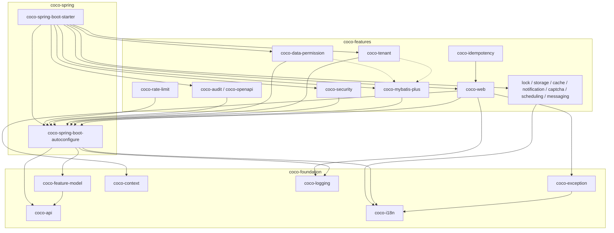

# 模块参考总览

> 本页回答：Coco Framework 仓库里有哪些 Maven 模块和非 Maven 目录、各自在哪一层、依赖方向如何、该先读哪个、详细说明在哪一页。
> 依据：根 `pom.xml` 的 `<modules>`、各模块 `pom.xml`、`coco-features/pom.xml` 与源码实读，内容对应仓库 `main` 分支。分层规则的权威来源是 [`AGENTS.md`](https://github.com/patton174/coco-framework/blob/main/AGENTS.md) 与 [`module-layout.md`](https://github.com/patton174/coco-framework/blob/main/coco-support/coco-document/architecture/module-layout.md)。

## 1. 五个顶层目录

| 目录 | 职责 | 详细页 |
| --- | --- | --- |
| `coco-build` | BOM、推荐父 POM、Maven 插件、构建期 Feature 清单与打包裁剪、2.x 旧坐标兼容门面 | [构建模块](Module-Build) |
| `coco-foundation` | 稳定公共契约，以及与 Spring Web 无关的基础设施：API、Feature 模型、i18n、异常、上下文、日志 | [基础模块](Module-Foundation) |
| `coco-spring` | Spring Boot 自动配置、运行时 Feature 计划、单 starter 组合入口 | [Spring 组合层](Module-Spring) |
| `coco-features` | 可独立启停的 Web 服务器能力（16 个 Feature 模块） | [web](Module-Web)、[数据与安全类](Module-Features-Data-And-Security)、[基础设施类](Module-Features-Infrastructure) |
| `coco-support` | 文档、开发工具、测试支持；不进入普通业务运行时 | [支持模块与仓库工具](Module-Support) |

边界提醒（[`AGENTS.md`](https://github.com/patton174/coco-framework/blob/main/AGENTS.md)）：`coco-admin` 与 `coco-generate` 是独立仓库，框架不得依赖它们；框架不维护业务样例，业务 / HTTP 验收在 `coco-admin/framework-acceptance`。

## 2. Reactor 模块总表

根 `pom.xml` 的 `<modules>` 共 23 项（`coco-features` 是聚合 pom，下含 16 个 Feature 模块）。下表按目录分组。

### 2.1 coco-build

| 路径 | artifactId | 打包 | 一句话职责 | 详情 |
| --- | --- | --- | --- | --- |
| `coco-build/coco-dependencies` | `coco-dependencies` | pom | 依赖管理 BOM | [build](Module-Build) |
| `coco-build/coco-parent` | `coco-parent` | pom | 业务应用推荐父 POM（导入 BOM，绑定 `repackage`、`coco:features`、`coco:prune-package`） | [build](Module-Build) |
| `coco-build/coco-maven-plugin` | `coco-maven-plugin` | maven-plugin | 构建期 Feature 装配与包裁剪 | [build](Module-Build) |
| `coco-build/coco-compatibility/*`（9 个） | `coco-config`、`coco-feature-runtime`、`coco-feature-web`、`coco-feature-mybatis-plus`、`coco-feature-audit`、`coco-feature-openapi`、`coco-feature-tenant`、`coco-feature-data-permission`、`coco-feature-security` | jar | 已发布旧坐标的无源码兼容门面，各自只依赖其规范制品 | [build](Module-Build) |

### 2.2 coco-foundation

| 路径 | artifactId | 一句话职责 | 详情 |
| --- | --- | --- | --- |
| `coco-foundation/coco-api` | `coco-api` | 稳定公共 API 契约（`CocoFeature`、`@CocoFeatures`、`CocoPage` 等） | [foundation](Module-Foundation) |
| `coco-foundation/coco-feature-model` | `coco-feature-model` | 标准 Feature 元数据、选择、清单、依赖解析 | [foundation](Module-Foundation) |
| `coco-foundation/coco-i18n` | `coco-i18n` | 国际化消息基础设施 | [foundation](Module-Foundation) |
| `coco-foundation/coco-exception` | `coco-exception` | 异常契约与工具 | [foundation](Module-Foundation) |
| `coco-foundation/coco-context` | `coco-context` | 请求上下文与 Trace 基础设施 | [foundation](Module-Foundation) |
| `coco-foundation/coco-logging` | `coco-logging` | 日志契约、句柄、格式化与默认输出 | [foundation](Module-Foundation) |

### 2.3 coco-spring

| 路径 | artifactId | 一句话职责 | 详情 |
| --- | --- | --- | --- |
| `coco-spring/coco-spring-boot-autoconfigure` | `coco-spring-boot-autoconfigure` | 配置绑定、Feature 运行时、自动配置与早期启动集成 | [spring](Module-Spring) |
| `coco-spring/coco-spring-boot-starter` | `coco-spring-boot-starter` | 业务应用唯一 starter（只组合依赖，无主代码） | [spring](Module-Spring) |

### 2.4 coco-features（聚合 pom `coco-features`，按 `<modules>` 顺序）

| 路径 | artifactId | Feature id | 一句话职责 | 详情 |
| --- | --- | --- | --- | --- |
| `coco-features/coco-web` | `coco-web` | `web` | 统一响应、异常处理、Trace、请求上下文、签名 / 加密 / 重放 | [web](Module-Web) |
| `coco-features/coco-mybatis-plus` | `coco-mybatis-plus` | `mybatis-plus` | 分页、SQL 守卫、动态多数据源路由、拦截器组装 | [数据与安全](Module-Features-Data-And-Security) |
| `coco-features/coco-audit` | `coco-audit` | `audit` | 审计事件管道与访问日志审计 | [数据与安全](Module-Features-Data-And-Security) |
| `coco-features/coco-security` | `coco-security` | `security` | 安全上下文（非认证实现） | [数据与安全](Module-Features-Data-And-Security) |
| `coco-features/coco-tenant` | `coco-tenant` | `tenant` | 租户上下文与 SQL 隔离 | [数据与安全](Module-Features-Data-And-Security) |
| `coco-features/coco-data-permission` | `coco-data-permission` | `data-permission` | 数据权限上下文与 SQL 谓词 | [数据与安全](Module-Features-Data-And-Security) |
| `coco-features/coco-openapi` | `coco-openapi` | `openapi` | OpenAPI 元数据，适配 SpringDoc | [数据与安全](Module-Features-Data-And-Security) |
| `coco-features/coco-rate-limit` | `coco-rate-limit` | `rate-limit` | Servlet 限流 | [基础设施](Module-Features-Infrastructure) |
| `coco-features/coco-idempotency` | `coco-idempotency` | `idempotency` | Servlet 写请求幂等 | [基础设施](Module-Features-Infrastructure) |
| `coco-features/coco-scheduling` | `coco-scheduling` | `scheduling` | 本地动态任务调度 | [基础设施](Module-Features-Infrastructure) |
| `coco-features/coco-lock` | `coco-lock` | `lock` | 方法级分布式锁 | [基础设施](Module-Features-Infrastructure) |
| `coco-features/coco-storage` | `coco-storage` | `storage` | 对象存储 SPI + 本地参考实现 | [基础设施](Module-Features-Infrastructure) |
| `coco-features/coco-messaging` | `coco-messaging` | `messaging` | 进程内消息与传输 SPI | [基础设施](Module-Features-Infrastructure) |
| `coco-features/coco-cache` | `coco-cache` | `cache` | Caffeine + Redis 两级缓存 | [基础设施](Module-Features-Infrastructure) |
| `coco-features/coco-notification` | `coco-notification` | `notification` | 通知通道 SPI（短信 / 邮件 / 站内信） | [基础设施](Module-Features-Infrastructure) |
| `coco-features/coco-captcha` | `coco-captcha` | `captcha` | 验证码 SPI（图形 / 滑块 / 短信码） | [基础设施](Module-Features-Infrastructure) |

[`AGENTS.md`](https://github.com/patton174/coco-framework/blob/main/AGENTS.md) 的“Current Architecture”没有逐个列出 `security`、`rate-limit`、`idempotency`、`scheduling`、`lock`、`storage`、`messaging`、`cache`、`notification`、`captcha` 这些模块，但它们都在 `coco-features/pom.xml` 与 `CocoFeature` 枚举里。`AGENTS.md` 是摘要而非全集，模块事实以 pom 与源码为准。

### 2.5 coco-support

| 路径 | artifactId | 一句话职责 | 详情 |
| --- | --- | --- | --- |
| `coco-support/coco-test` | `coco-test` | 共享测试支持（`CocoTestSupport`） | [support](Module-Support) |
| `coco-support/coco-feature-archive-smoke` | `coco-feature-archive-smoke` | 仅测试用的 Boot 归档夹具，验证清单与裁剪 | [support](Module-Support) |

非 Reactor（无 pom）：`coco-support/coco-document`、`coco-support/coco-tools`，同样见 [support](Module-Support)。

## 3. 依赖方向图

只画关键边，节点名与 `pom.xml` 一致；虚线表示 optional 依赖。完整依赖表见下一节。

读图要点：

- `coco-spring-boot-starter` 到 `coco-rate-limit` 与 `coco-idempotency` **没有**边：这两个模块由 `coco:features` 在构建期补加（见 [Spring 组合层](Module-Spring)）。
- `coco-idempotency` 依赖 `coco-web`；`coco-tenant`、`coco-data-permission` 对 `coco-mybatis-plus` 是 optional。
- “lock / storage / cache / notification / captcha / scheduling / messaging”这一组只依赖 foundation 模块，不依赖 `coco-spring-boot-autoconfigure`；它们都依赖 `coco-i18n`，其中 lock、storage、cache、notification、captcha 还依赖 `coco-exception`，scheduling 与 messaging 依赖 `coco-context`。
- 没有任何框架模块依赖 `coco-config` / `coco-feature-runtime` 兼容门面（仅 starter 的测试作用域使用）。
- 图里省略的边（如 `coco-security` → `coco-exception` / `coco-i18n` / `coco-context`）见下表。

## 4. Coco 模块间依赖表

“编译 / 运行”列只列 Coco 模块；括号内是 optional 或测试依赖。

| 模块 | 编译 / 运行 | optional | 测试 |
| --- | --- | --- | --- |
| `coco-api` | — | — | — |
| `coco-context` | — | — | — |
| `coco-i18n` | — | — | — |
| `coco-logging` | — | — | — |
| `coco-exception` | `coco-i18n` | — | — |
| `coco-feature-model` | `coco-api` | — | — |
| `coco-spring-boot-autoconfigure` | `coco-api`、`coco-i18n`、`coco-logging`、`coco-feature-model` | `coco-context` | — |
| `coco-maven-plugin` | `coco-api`、`coco-feature-model` | — | `coco-exception` |
| `coco-web` | `coco-context`、`coco-exception`、`coco-i18n`、`coco-logging`、`coco-spring-boot-autoconfigure` | — | — |
| `coco-mybatis-plus` | `coco-i18n`、`coco-exception`、`coco-spring-boot-autoconfigure` | `coco-api`、`coco-context` | — |
| `coco-audit` | `coco-i18n`、`coco-logging`、`coco-spring-boot-autoconfigure` | — | — |
| `coco-security` | `coco-exception`、`coco-i18n`、`coco-context`、`coco-spring-boot-autoconfigure` | — | `coco-test` |
| `coco-tenant` | `coco-exception`、`coco-i18n`、`coco-context`、`coco-spring-boot-autoconfigure` | `coco-mybatis-plus` | — |
| `coco-data-permission` | 同 `coco-tenant` | `coco-mybatis-plus` | — |
| `coco-openapi` | `coco-i18n`、`coco-spring-boot-autoconfigure` | — | — |
| `coco-rate-limit` | `coco-spring-boot-autoconfigure`、`coco-context`、`coco-exception`、`coco-i18n` | — | — |
| `coco-idempotency` | `coco-web`、`coco-i18n` | — | — |
| `coco-scheduling` | `coco-context`、`coco-i18n` | — | — |
| `coco-lock` | `coco-exception`、`coco-i18n` | — | — |
| `coco-storage` | `coco-exception`、`coco-i18n` | — | — |
| `coco-messaging` | `coco-context`、`coco-i18n` | — | — |
| `coco-cache` | `coco-exception`、`coco-i18n` | — | — |
| `coco-notification` | `coco-exception`、`coco-i18n` | — | — |
| `coco-captcha` | `coco-exception`、`coco-i18n` | — | — |
| `coco-spring-boot-starter` | `coco-api`、`coco-context`、`coco-exception`、`coco-i18n`、`coco-logging`、`coco-web`、`coco-mybatis-plus`、`coco-audit`、`coco-security`、`coco-tenant`、`coco-data-permission`、`coco-openapi`、`coco-scheduling`、`coco-lock`、`coco-storage`、`coco-messaging`、`coco-cache`、`coco-notification`、`coco-captcha`、`coco-spring-boot-autoconfigure` | — | `coco-feature-runtime`、`coco-config` |
| `coco-feature-archive-smoke` | `coco-spring-boot-starter`（父 POM 为 `coco-parent`） | — | — |
| 兼容门面 → 规范制品 | `coco-config`、`coco-feature-runtime` → `coco-spring-boot-autoconfigure`；`coco-feature-web` → `coco-web`；`coco-feature-mybatis-plus` → `coco-mybatis-plus`；`coco-feature-audit` → `coco-audit`；`coco-feature-openapi` → `coco-openapi`；`coco-feature-tenant` → `coco-tenant`；`coco-feature-data-permission` → `coco-data-permission`；`coco-feature-security` → `coco-security` | — | — |

## 5. Feature id 与模块对照

`CocoFeature` 枚举当前 16 项，`StandardCocoFeatures` 对它们全部 `defaultEnabled=true`。

| Feature id | 枚举 | 模块 | Feature 依赖 |
| --- | --- | --- | --- |
| `web` | `WEB` | `coco-web` | — |
| `mybatis-plus` | `MYBATIS_PLUS` | `coco-mybatis-plus` | — |
| `audit` | `AUDIT` | `coco-audit` | — |
| `security` | `SECURITY` | `coco-security` | — |
| `tenant` | `TENANT` | `coco-tenant` | `mybatis-plus`、`security` |
| `data-permission` | `DATA_PERMISSION` | `coco-data-permission` | `mybatis-plus`、`security` |
| `openapi` | `OPENAPI` | `coco-openapi` | `web`、`security` |
| `rate-limit` | `RATE_LIMIT` | `coco-rate-limit` | `web` |
| `idempotency` | `IDEMPOTENCY` | `coco-idempotency` | `web` |
| `scheduling` | `SCHEDULING` | `coco-scheduling` | — |
| `lock` | `LOCK` | `coco-lock` | — |
| `storage` | `STORAGE` | `coco-storage` | — |
| `messaging` | `MESSAGING` | `coco-messaging` | — |
| `cache` | `CACHE` | `coco-cache` | — |
| `notification` | `NOTIFICATION` | `coco-notification` | — |
| `captcha` | `CAPTCHA` | `coco-captcha` | — |

“默认启用”指 Feature 计划层面；各模块自己的 `enabled` 属性默认值不同（例如 `rate-limit`、`idempotency`、`lock`、`cache`、`captcha`、`storage`、`notification` 默认为 `false`），见各详情页。Feature 的个数与成员以 `CocoFeature` 枚举为准（16 项）。

## 6. 配置前缀索引

| 前缀 | 所在模块 | 详情页 |
| --- | --- | --- |
| `coco.features` | `coco-spring-boot-autoconfigure` | [spring](Module-Spring) |
| `coco.banner`、`coco.async`、`coco.jackson` | `coco-spring-boot-autoconfigure` | [spring](Module-Spring) |
| `coco.common.i18n`、`coco.logging` | `coco-i18n`、`coco-logging` | [foundation](Module-Foundation) |
| `coco.web`（含 `trace`、`response`、`response-wrap`、`access-log`、`request-body`、`signature`、`encryption`、`replay`、`context`）、`coco.web.cors`、`coco.web.security-headers`、`coco.web.page` | `coco-web` | [web](Module-Web) |
| `coco.mybatis-plus`、`coco.tenant`、`coco.data-permission`、`coco.security`、`coco.audit`、`coco.openapi` | 对应模块 | [数据与安全](Module-Features-Data-And-Security) |
| `coco.rate-limit`、`coco.idempotency`、`coco.lock`、`coco.cache`、`coco.captcha`、`coco.scheduling`、`coco.storage`、`coco.messaging`、`coco.notification` | 对应模块 | [基础设施](Module-Features-Infrastructure) |

## 7. 建议的源码阅读顺序

1. `coco-api`：`CocoFeature`、`@CocoFeatures`，理解 Feature 标识。
2. `coco-feature-model`：`StandardCocoFeatures`，理解 Feature 元数据与解析。
3. `coco-i18n` → `coco-exception` → `coco-context` → `coco-logging`：基础设施契约。
4. `coco-spring-boot-autoconfigure`：`CocoConfigAutoConfiguration`、`CocoFeatureAutoConfigurationImportFilter`、`@ConditionalOnCocoFeature`。
5. `coco-maven-plugin`：`CocoFeaturesMojo`、`CocoPackagePruneMojo`，理解构建期装配与裁剪。
6. `coco-web`：最大模块，先看 `CocoWebAutoConfiguration` 与过滤器顺序。
7. 其余 Feature：先看 `mybatis-plus` / `tenant` / `data-permission` 这条 SQL 链，再按需读基础设施类模块。

## 8. 兼容门面与本地残留目录

- **兼容门面**：`coco-build/coco-compatibility/*` 共 9 个，是无源码 jar，仅为已发布旧坐标在 2.x 内继续可解析。不要把它们当新依赖入口，框架内部也不得依赖它们（[`AGENTS.md`](https://github.com/patton174/coco-framework/blob/main/AGENTS.md)）。
- **本地构建残留目录**：下面三个目录都只有 `target/` 或 `.flattened-pom.xml`，没有 `pom.xml`，不在根 `<modules>` 中，没有被 Git 跟踪的文件，产物已被 `.gitignore` 忽略。它们不是仓库内容，`mvn clean` 或手动删除即可：
  - `coco-spring/coco-config/`
  - `coco-support/coco-test-support/`
  - `coco-build/coco-compatibility/coco-test/`
- 文档与实现存在出入：`module-layout.md` 把 `coco-test-support` 写作 `coco-test` 的新主制品，当前 Reactor 的实际模块是 `coco-support/coco-test`（artifactId `coco-test`），以根 `pom.xml` 为准。

## 9. 相关页面

- [构建模块：BOM、父 POM、Maven 插件与兼容门面](Module-Build)
- [基础模块：coco-foundation](Module-Foundation)
- [Spring 组合层：autoconfigure 与 starter](Module-Spring)
- [coco-web：Web 运行时](Module-Web)
- [数据与安全类 Feature](Module-Features-Data-And-Security)
- [基础设施类 Feature](Module-Features-Infrastructure)
- [支持模块与仓库工具](Module-Support)
- [架构总览](Architecture)
- [Feature 机制：构建期与运行期](Feature-System)
- [速查：开发任务到文件 / 目录](Where-To-Find-Things)
- [术语表](Glossary)
