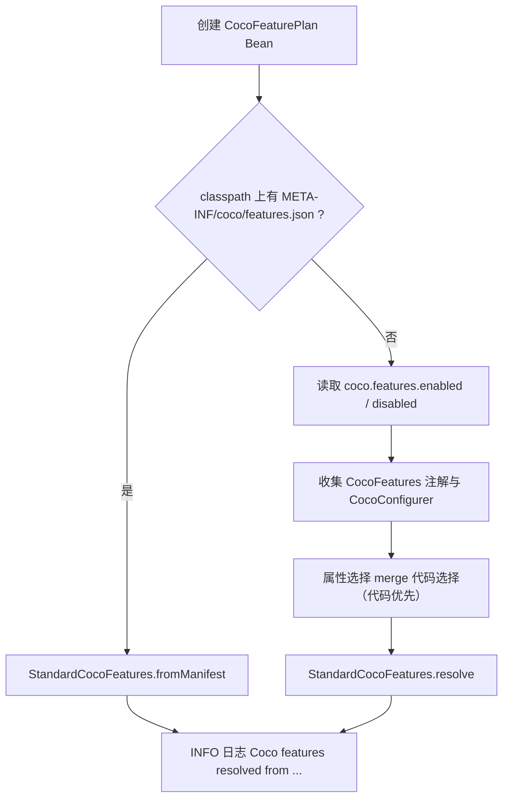

# Spring 组合层：autoconfigure 与 starter

> 本页回答：`coco-spring/` 下的 `coco-spring-boot-autoconfigure` 装配了什么、`coco-spring-boot-starter` 组合了什么、有哪些注册文件、扩展点和配置属性。
> 依据：两个模块的 `pom.xml`、`src/main/java`、`META-INF/spring.factories`、`AutoConfiguration.imports` 实读，内容对应仓库 `main` 分支。

## 1. 两个模块的分工

| 模块 | 路径 | 职责（pom `<description>`） | 有主代码吗 |
| --- | --- | --- | --- |
| `coco-spring-boot-autoconfigure` | `coco-spring/coco-spring-boot-autoconfigure` | 配置绑定、Feature 运行时、自动配置与早期启动集成 | 有（26 个主类，不含 `package-info`） |
| `coco-spring-boot-starter` | `coco-spring/coco-spring-boot-starter` | 业务应用唯一 starter | **没有主代码**，只有 pom 与测试 |

[`AGENTS.md`](https://github.com/patton174/coco-framework/blob/main/AGENTS.md) 的规则：starter 只组合能力，不拥有行为；不要往 starter 里加 Feature 行为。

`coco-spring/coco-config/` 目录下只有 `target/` 与 `.flattened-pom.xml`（均被 `.gitignore` 忽略），没有 pom 与源码，不在根 `<modules>` 里，也没有被 Git 跟踪的文件，属于本地构建残留，不是仓库内容；`mvn clean` 或手动删除即可。真正的 `coco-config` 坐标现在是 `coco-build/coco-compatibility/coco-config` 的无源码门面，见 [构建模块](Module-Build)。

## 2. coco-spring-boot-autoconfigure

### 2.1 依赖

| 类别 | 内容 |
| --- | --- |
| 编译 | `coco-api`、`coco-i18n`、`coco-logging`、`coco-feature-model`、`spring-boot`、`spring-boot-autoconfigure` |
| optional | `coco-context`、`spring-context`、`jackson-databind`、`jackson-datatype-jsr310`、`spring-boot-jackson`、`spring-boot-configuration-processor` |
| 测试 | `spring-boot-test`、`logback-classic`、`assertj-core`、`junit-jupiter`（15 个测试类） |

`coco-context` 是 optional：`CocoContextTaskDecorator` 依赖它，只有 classpath 上有 `coco-context` 时才安全（starter 会带上它）。

### 2.2 包与公开类型

源码根：`coco-spring/coco-spring-boot-autoconfigure/src/main/java/io/github/coco/`。**包名沿用迁移前的旧模块包名**（见 §2.6），所以包名不等于“源码在哪个 jar”。

| 包 | 类型 | 说明 |
| --- | --- | --- |
| `common.autoconfigure` | `CocoCommonAutoConfiguration` | Bean：`cocoMessageSource`（`MessageSource`，带 `@ConditionalOnMissingBean(name = "cocoMessageSource")`）、`CocoLocaleResolver`、`CocoMessageService`。绑定 `CocoCommonProperties`（前缀 `coco.common`） |
| `common.logging.autoconfigure` | `CocoCommonLoggingAutoConfiguration` | Bean：`CocoLogHandleRegistry`、`CocoLogSink`（`coco.logging.async.enabled` 为 true 时包装成 `AsyncCocoLogSink`）、`CocoAsyncLogDropListener`、`CocoLogManager`、`CocoLifecycleLogger`、`CocoAccessLogFormatter`、`CocoAccessLogRecorder`（条件 `coco.logging.access-log.enabled`）。绑定 `CocoLoggingProperties` |
| `config` | `CocoConfigAutoConfiguration` | Bean：`CocoFeaturePlan`、`CocoFeatureManager`、`cocoConfigMessageBundleRegistrar` |
| `config` | `CocoProperties`（前缀 `coco`）、`CocoFeatureProperties`（`features.enabled|disabled`） | 根配置属性 |
| `config` | `CocoFeatureManager`（接口：`isEnabled`、`enabledFeatures`、`disabledFeatures`）、`DefaultCocoFeatureManager` | 运行期查询 Feature 状态 |
| `config` | `CocoFeatureSelectionCollector`、`MutableCocoFeatureRegistry` | **包私有**（`final class`），不是公开 API；前者收集 `@CocoFeatures` 与 `CocoConfigurer` 声明 |
| `feature.registry` | `CocoFeatureRegistryAutoConfiguration` | 仅注册 Feature 模型的消息资源包 |
| `feature.runtime.autoconfigure` | `CocoFeatureRuntimeAutoConfiguration` | 仅注册运行时消息资源包 |
| `feature.runtime.autoconfigure` | `CocoFeatureAutoConfigurationImportFilter` | `AutoConfigurationImportFilter`，按 Feature 状态过滤自动配置（见 §2.4） |
| `feature.runtime.condition` | `@ConditionalOnCocoFeature(CocoFeature)`、`CocoRuntimeFeatureResolver` | 条件注解（`@Target({TYPE, METHOD})`）与解析器；`OnCocoFeatureCondition` 是包私有判断器 |
| `spring.boot` | `CocoAutoConfiguration` | `@AutoConfiguration(after = CocoCommonLoggingAutoConfiguration)`；Bean `CocoStartupBanner`、starter 消息包注册器 |
| `spring.boot.async` | `CocoAsyncAutoConfiguration`、`CocoAsyncProperties`、`CocoContextTaskDecorator` | 异步线程池 |
| `spring.boot.banner` | `CocoSpringApplicationRunListener`、`CocoSpringBanner`、`CocoStartupBanner`、`CocoBannerProperties` | 启动 banner 与生命周期日志 |
| `spring.boot.jackson` | `CocoJacksonAutoConfiguration`、`CocoJacksonProperties` | Jackson 定制 |
| `spring.boot.logging` | `CocoLoggingEnvironmentPostProcessor` | 日志默认值注入 |

### 2.3 Feature 计划如何产生

`CocoConfigAutoConfiguration#cocoFeaturePlan` 的逻辑：

- **有清单**：直接 `fromManifest`，运行期不再合并业务配置；清单是 `coco-maven-plugin` 在构建期生成的（见 [构建模块](Module-Build)）。
- **无清单**（例如在 IDE 里直接运行、没有经过 `coco:features`）：用 `coco.features.*` 属性与代码声明合并后 `resolve`，代码声明优先。
- 条件注解 `@ConditionalOnCocoFeature` 的 `OnCocoFeatureCondition` 同样先读清单，没有清单时用 `Binder` 绑定 `coco.features.enabled|disabled`（`CocoRuntimeFeatureResolver`）。

16 个 Feature 中，使用 `@ConditionalOnCocoFeature` 的有 web、mybatis-plus、audit、security、tenant、data-permission、openapi、rate-limit、idempotency；scheduling、lock、storage、messaging、cache、notification、captcha 的自动配置类上没有该注解：`coco.features.disabled` 对它们在构建期影响装配、裁剪与清单，运行期开关靠各自的 `coco.<feature>.enabled` 属性。设计意图未见文档说明，行为以各模块 `src/main/java` 下的自动配置类源码为准（详见 [Feature 机制：构建期与运行期](Feature-System)）。

### 2.4 `CocoFeatureAutoConfigurationImportFilter`

注册在 `spring.factories`。

- 当 `mybatis-plus` Feature 未启用时，过滤掉 MyBatis-Plus 的 5 个自动配置：`MybatisPlusInnerInterceptorAutoConfiguration`、`IdentifierGeneratorAutoConfiguration`、`MybatisPlusLanguageDriverAutoConfiguration`、`MybatisPlusAutoConfiguration`、`DdlAutoConfiguration`（均在 `com.baomidou.mybatisplus.autoconfigure`）。
- 当 `mybatis-plus` 未启用，并且环境里没有 `spring.datasource.url|jdbc-url|driver-class-name|jndi-name|type`，且 classpath 上没有嵌入式驱动（`org.h2.Driver`、`org.hsqldb.jdbcDriver`、`org.apache.derby.jdbc.EmbeddedDriver`）时，额外过滤 Spring Boot 的 `DataSourceAutoConfiguration`、`JndiDataSourceAutoConfiguration`、`XADataSourceAutoConfiguration`（均在 `org.springframework.boot.jdbc.autoconfigure`）。

目的是让禁用 MyBatis-Plus 的应用不会因为缺少数据源而启动失败。

### 2.5 注册文件

`META-INF/spring/org.springframework.boot.autoconfigure.AutoConfiguration.imports`（按文件顺序）：

1. `io.github.coco.common.autoconfigure.CocoCommonAutoConfiguration`
2. `io.github.coco.common.logging.autoconfigure.CocoCommonLoggingAutoConfiguration`
3. `io.github.coco.feature.registry.CocoFeatureRegistryAutoConfiguration`
4. `io.github.coco.config.CocoConfigAutoConfiguration`
5. `io.github.coco.feature.runtime.autoconfigure.CocoFeatureRuntimeAutoConfiguration`
6. `io.github.coco.spring.boot.CocoAutoConfiguration`
7. `io.github.coco.spring.boot.async.CocoAsyncAutoConfiguration`
8. `io.github.coco.spring.boot.jackson.CocoJacksonAutoConfiguration`

`META-INF/spring.factories`：

| 扩展点 | 实现 |
| --- | --- |
| `org.springframework.boot.SpringApplicationRunListener` | `io.github.coco.spring.boot.banner.CocoSpringApplicationRunListener` |
| `org.springframework.boot.EnvironmentPostProcessor` | `io.github.coco.spring.boot.logging.CocoLoggingEnvironmentPostProcessor` |
| `org.springframework.boot.autoconfigure.AutoConfigurationImportFilter` | `io.github.coco.feature.runtime.autoconfigure.CocoFeatureAutoConfigurationImportFilter` |

消息资源包：`coco-config-messages`、`coco-feature-runtime-messages`、`coco-spring-boot-starter-messages`（各有默认、`_en_US`、`_zh_CN`）。`coco-feature-registry-messages` 在 `coco-feature-model` 里，由 `CocoFeatureRegistryAutoConfiguration` 注册。

### 2.6 包名保留说明

按 [`AGENTS.md`](https://github.com/patton174/coco-framework/blob/main/AGENTS.md) 与 [`module-layout.md`](https://github.com/patton174/coco-framework/blob/main/coco-support/coco-document/architecture/module-layout.md)：Java 包名、FQCN、配置前缀不因目录或 artifactId 重命名而改变。所以 `io.github.coco.config`、`io.github.coco.feature.runtime.*`、`io.github.coco.feature.registry`、`io.github.coco.common.*` 都留在这个模块里，包名保留不等于模块仍在旧 jar。设计规格：`coco-support/coco-document/superpowers/specs/2026-07-12-coco-spring-composition.md`。

> 排障提示：若编译本模块时 `javac` 报 `package ... does not match the expected package`、`class ... should be declared in a file named` 或重复类，先用 `git status -sb` 与 `git diff` 检查是否有本地改动，确认每个类的 `package` 声明与所在目录一致（例如目录 `io/github/coco/config/` 下的类应声明 `package io.github.coco.config;`）。把 `package` 改回与目录一致，或用 `git stash` 暂存自己的改动后重试。

### 2.7 扩展点

| 想替换什么 | 怎么做 |
| --- | --- |
| 消息源 / 区域解析 / 消息服务 | 声明同类型 Bean（`cocoMessageSource` 按名称、`CocoLocaleResolver` 与 `CocoMessageService` 按类型 `@ConditionalOnMissingBean`） |
| 日志注册表、Sink、丢弃监听器、LogManager、访问日志格式化器 / 记录器 | 声明同类型 Bean |
| 模块自己的消息资源包 | 声明 `CocoMessageBundleRegistrar` Bean（见 [约定与规范](Conventions)） |
| 模块自己的日志句柄 | 声明 `CocoLogHandleRegistrar` Bean |
| 异步线程池 | 声明名为 `cocoTaskExecutor` 的 Bean |
| Feature 计划 / 管理器 | 声明 `CocoFeaturePlan` / `CocoFeatureManager` Bean（不建议；一般用属性或注解） |
| 声明 Feature 开关 | `coco.features.enabled|disabled`、`@CocoFeatures`；`CocoConfigurer` 已废弃 |

### 2.8 配置属性

| 前缀 | 键 → 默认值 | 来源 |
| --- | --- | --- |
| `coco.features` | `enabled`（`Set<CocoFeature>`，空）、`disabled`（空） | `config/CocoProperties.java`、`CocoFeatureProperties.java` |
| `coco.banner` | `enabled=true`、`title="coco spring"`、`version`（空） | `spring/boot/banner/CocoBannerProperties.java` |
| `coco.async` | `core-pool-size=8`、`max-pool-size=32`、`queue-capacity=1000`、`thread-name-prefix="coco-async-"`；`coco.async.enabled` 只作为条件（`matchIfMissing=true`），不是属性字段 | `spring/boot/async/CocoAsyncProperties.java`、`CocoAsyncAutoConfiguration.java` |
| `coco.jackson` | `long-to-string=true`、`fail-on-unknown-properties=false`、`write-dates-as-timestamps=false` | `spring/boot/jackson/CocoJacksonProperties.java` |
| `coco.common.i18n` | 见 [基础模块](Module-Foundation) | `coco-i18n` |
| `coco.logging` | 见 [基础模块](Module-Foundation) | `coco-logging` |

补充说明：

- `coco.async`：Bean 名 `cocoTaskExecutor`（`ThreadPoolTaskExecutor`，条件 `@ConditionalOnClass(ThreadPoolTaskExecutor)` 且 `coco.async.enabled` 缺省为 true），任务装饰器为 `CocoContextTaskDecorator`，用 `CocoContextSnapshot.compose(...)` 传播请求上下文、TraceId 与分页上下文。
- `coco.jackson`：`CocoJacksonAutoConfiguration` 在 `JacksonAutoConfiguration` 之前运行；`long-to-string` 为 true 时把 `Long`/`long` 序列化为字符串，并设置 `FAIL_ON_UNKNOWN_PROPERTIES`。`write-dates-as-timestamps` 在 `CocoJacksonProperties` 里有 getter / setter，但 `CocoJacksonAutoConfiguration` 的 customizer 代码没有读取它，因此当前设置该键不会改变序列化行为；设计意图未见文档说明，行为以 `CocoJacksonAutoConfiguration` 源码为准。
- `CocoLoggingEnvironmentPostProcessor`：`coco.logging.enabled=false` 时不处理；否则追加名为 `cocoLoggingDefaults` 的属性源（`addLast`，优先级最低，业务配置可覆盖），设置 `logging.pattern.console`、`logging.level.io.github.coco*`（INFO）；`coco.logging.quiet-spring=true`（默认）时再把 `spring.main.log-startup-info` 设为 `false`，并把 Spring、Tomcat、DispatcherServlet 相关日志压到 `WARN`。
- `CocoSpringApplicationRunListener`：`coco.banner.enabled` 缺省为 true 时输出 Coco banner；`coco.logging.enabled` 缺省为 true 时在 `ready` / `failed` 阶段通过 `CocoLifecycleLogger` 输出生命周期日志。

### 2.9 测试

`coco-spring-boot-autoconfigure/src/test`：15 个 `*Test` 类。

## 3. coco-spring-boot-starter

### 3.1 组合内容

**编译 / 运行依赖**（pom 实读）：

- foundation：`coco-api`、`coco-context`、`coco-exception`、`coco-i18n`、`coco-logging`
- spring：`coco-spring-boot-autoconfigure`
- Feature（14 个）：`coco-web`、`coco-mybatis-plus`、`coco-audit`、`coco-security`、`coco-tenant`、`coco-data-permission`、`coco-openapi`、`coco-scheduling`、`coco-lock`、`coco-storage`、`coco-messaging`、`coco-cache`、`coco-notification`、`coco-captcha`
- 第三方：`spring-boot-starter-web`

**测试作用域**：`coco-feature-runtime`、`coco-config`（两个兼容门面）、`spring-boot-test`、`logback-classic`、`assertj-core`、`junit-jupiter`。

### 3.2 不包含 `coco-rate-limit` 与 `coco-idempotency`

这两个 Feature 不在 starter 依赖里。`CocoRateLimitStarterDependencyContractTest` 断言 starter 的直接依赖不得出现它们；它们由 `coco:features` 在构建期按 Feature 计划补加（`CocoFeaturesMojo#applyFeatureDependencies`）。`coco-idempotency` 还依赖 `coco-web`。两者的运行期开关默认都是关闭的（`coco.rate-limit.enabled=false`、`coco.idempotency.enabled=false`），见 [基础设施类 Feature](Module-Features-Infrastructure)。

### 3.3 测试

`coco-spring/coco-spring-boot-starter/src/test/java/io/github/coco/spring/boot/` 下 6 个 `*Test` + 1 个 `*IT`：

| 测试 | 作用 |
| --- | --- |
| `CocoAutoConfigurationTest` | 自动配置行为 |
| `CocoLifecycleLoggerTest` | 生命周期日志 |
| `CocoSpringApplicationRunListenerTest` | 启动监听器 |
| `CocoRateLimitStarterDependencyContractTest` | starter 不得直接依赖限流 / 幂等 |
| `CocoMybatisPlusStarterDependencyContractTest` | starter 依赖规范坐标 `coco-mybatis-plus` 且不得依赖 `coco-feature-mybatis-plus`；门面 pom 依赖 `coco-mybatis-plus` |
| `CocoSpringCompositionClasspathTest` | 迁移后的自动配置与 `spring.factories` 扩展点在 starter 与兼容门面同时在 classpath 时只注册一次 |
| `CocoStarterSmokeIT` | 以 starter 默认值启动 Servlet 应用，断言 `cocoStartupBanner` Bean 存在，且 `CocoMessageService`、`CocoWebRequestContextResolver` 可取到 |

### 3.4 业务接入

业务应用用 `coco-parent` 作父 POM、依赖这一个 starter 即可，示例直接看官网 [`getting-started.md`](https://github.com/patton174/coco-framework/blob/main/website/docs/getting-started.md)。框架仓库里没有可独立运行的 demo，业务 / HTTP 验收在独立仓库 `coco-admin/framework-acceptance`。

## 4. 相关页面

- [模块参考总览](Module-Overview)
- [基础模块：coco-foundation](Module-Foundation)
- [构建模块：BOM、父 POM、Maven 插件与兼容门面](Module-Build)
- [coco-web：Web 运行时](Module-Web)
- [Feature 机制：构建期与运行期](Feature-System)
- [指南：新增或调整自动配置](Guide-Add-Auto-Configuration)
- [约定与规范](Conventions)
